# Hackable 3D, phase D1: code bricks in 3D, solo, November 4, 2026

**Branch:** `claude/hackable-3d-d1-18eb14`, built on production main 32ce3e0b with the spike (`claude/hackable-3d-spike-f89ca4`,
f3df2609) merged in as a merge commit. It is committed locally only: not pushed, no PR, not deployed.

Three helper branches were merged into it:

| Branch | What it did |
|---|---|
| `claude/h3d-d1-blocks` | The code editor's 3D blocks and palette |
| `claude/h3d-d1-ways` | The addresses, projects, the picker, Open in Hackable 3D, and refusing rooms |
| `claude/h3d-d1-feel` | The Hero measured against the classic Rapier character (FEEL.md) |

**Mock:** https://claude.ai/artifact/GCnbm8BdUfwNdE1A18nWSW. Its screens are Build, Code, the 3D blocks, the Hero, the
six code bricks and Play together.

## What a kid can do now

1. **Start a 3D game with code inside.** There are two ways in:
   - **Make a game:** the 3D row gains "Start with code inside" (`/3d/hackable?new=1`). The classic builder's Start
     stays first and primary.
   - **The classic 3D builder:** This project → **Open in Hackable 3D** copies the build into a new Hackable 3D project
     and opens it. The classic build is left exactly as it was.
2. **Build on the plate.**
   - The Bricks drawer has nine classic build bricks in 12 colours. A see-through box shows where a brick goes, a click
     places it on the stud under the pointer (stacking on what is there), and Turn (R) turns it.
   - Erase, Undo and Redo work as in 2D.
   - Drag to look around, right-drag or Shift-drag to slide, scroll to zoom.
3. **Place code bricks that already work:** Bounce pad, Mover, Spinner, Coin, Goal, and Button + Door (placed as a
   pair).
   - The Hero and the Goal are one per world: placing one again moves it.
   - "+ New brick" makes a brick of the kid's own and opens its code.
4. **Open a code brick's card.** The card has Sliders (every one, or just this one), Look, and See inside, which opens
   Code beside the running world. In Code:
   - Restart applies the kid's changes ("Press Restart to try your changes").
   - "Just this brick" runs the brick alone on an empty plate with a Hero.
   - The palette has a **3D** category in place of Platformer, and z blocks in Motion.
5. **Play.**
   - The camera follows the Hero; drag to turn it. The Hero walks the way the camera looks.
   - Arrows or WASD move, Space jumps, Shift or X runs.
   - The HUD shows coins and time, and "You made it!" with Play again and Keep building.
6. **Save and reopen.** Saving uses the same project and save paths as the Platformer and Racing (this browser, the
   account, a file), with kit `'3d'`. My projects shows a "Hackable 3D" kind with a picture of the world.

## What was built

### Engine: `src/platformer/lab/kit3d`

The spike's extension became the kit.

- **`core/index.ts`** registers `KIT_ENGINES['3d']`. The kit has its own `instantiate`: every copy gets a z and a box,
  and plain bricks stay scenery.
- **`kits.ts`** sets `KITS['3d'].ready`.
- **`core/project.ts` `validateDesign`** calls `validate3d.ts` for kit 3d. It checks:
  - a z on every copy;
  - at most 2,000 known build bricks on the plate;
  - the plate size (64, 96 or 128, like the classic);
  - custom parts;
  - positive boxes and known models.
- **The shared contracts are untouched.** 3D fields stay as type intersections in `contracts3d.ts`, so the parallel
  lanes' edits to `contracts.ts` won't conflict.
- **Studs on every distance block** (`blocks3d.ts`). Positions and "go to" are in studs, and so are change by, z
  position, distance to, "x position of", speeds (studs a second) and launch. Scratch's own Motion blocks are taught
  studs and a third axis:
  - move steps runs along the plate in the direction the brick faces;
  - glide keeps z;
  - "go to (brick)" includes z;
  - "if on edge, bounce" does nothing on a plate and is hidden.

  Reporters round to a millionth, so a kid reads 3, not 3.0000000000000004.
- **New blocks:**
  - go to x: y: z:
  - change z by
  - set z to
  - z position
  - launch who landed on me up at
  - go back to where I started

  The Platformer's speed blocks gain z, and "when I bump" gains front and back.
- **Moving platforms carry the Hero.** This was the spike's gap.
  - Platforms (solid, no gravity, not a character) move first in each 60 Hz substep and carry whoever stands on them.
  - A solid moved by its *scripts* ("change y by", "go to") also carries its riders, from where the last physics step
    left it (`body3.last`, which is in rewinds and keyframes).
  - Platforms pass through Heroes rather than being stopped by them.
- **Heroes are solid** (owner decision). They stand on and bump into each other. The test puts one Hero on another's
  head.
- **"touching" compares turned footprints** (separating axes, + − × only), so a Spinner's bar touches what it sweeps.
  A solid turned by a quarter turn swaps width and depth. Other turns turn only the drawing and "touching".
- **Plate size** comes from the design (64, 96 or 128), and custom parts come from the design's own list
  (`customParts3d`), never from this browser's global registry.
- **The Hero runs with Shift** (as in the classic) as well as X.
- **Snap distance is a whole plate (0.2)** after the feel measurements; see below.

### The six code bricks: `src/platformer/lab/studio/three/bricks3d.ts`

Each is a real brick: blocks built with the 2D starter's own builder, compiled, labelled, with Sliders as `showInBuild`
variables. Every block loads in the editor and compiles back unchanged (`workspaceRoundTrip3d.test.ts`).

| Brick | Its blocks | Sliders |
|---|---|---|
| Bounce pad | when ⚑: solid on · when I bump [bottom] of [Hero]: launch who landed on me up at (launch speed) | launch speed 15 |
| Mover | when ⚑: solid on, forever: set x speed to (speed), wait (seconds), set x speed to (0 − speed), wait (seconds) | speed 2, seconds 2 |
| Spinner | when ⚑: forever: turn ↻ (turn) degrees, if touching Hero: broadcast [back to start] | turn 3 |
| Coin | when ⚑: show, forever: turn ↻ (spin), if touching Hero: broadcast [coin collected], hide, stop this script | spin 6 |
| Goal | when ⚑: solid on · when I bump [any side] of [Hero]: broadcast [you win], say [You made it!] for 2 seconds | (none) |
| Button + Door | Button: when ⚑: solid on, set pressed to 0 · when I bump [bottom] of [Hero]: if pressed = 0, set pressed to 1, broadcast [open]. Door: when ⚑: solid on · when I receive [open]: repeat 10: change y by (how high / 10) | Door: how high 2 |

Other parts:
- **The Hero:** when I receive [back to start]: go back to where I started.
- **The Stage:** counts coins.
- **The starter world:** a deck four bricks up with a wall behind, the Bounce pad as the way up, three Coins on the way
  and the Goal on top. A test plays it to "You made it!" with three coins.

### The studio: same shell, its own slots

- **`screen/kitParts.tsx` gains four optional slots:** `Stage`, `Drawer`, `Strip` and `TestRoom`. `StudioShell` uses a
  kit's own when it has one. The 2D kits are unchanged and use none of them.
- **`kitScreens.ts` gets a `'3d'` entry:** starter, Hero, palette flags and words. Its controls line is "Arrows or WASD
  move, Space jumps, Shift or X runs, drag to look around".
- **`Stage3D.tsx` + `render3d.ts`.** three.js only draws:
  - build bricks use the classic part geometry, one InstancedMesh per part with a colour per instance;
  - code bricks and Heroes are simple models in their colour and box size, moved smoothly between ticks;
  - the Hero has a round shadow on what is below it;
  - in Build, the camera frames what is built.
- **`Drawer3D.tsx`** holds the drawer and the placing chip ("Placing a 2 × 4 brick. Click a stud to place it.", Turn
  (R), Done).
- **`build3d.ts`** decides where a click puts things and makes the edits, each one undo step.
- **`TestRoom3D.tsx`** is "Just this brick" (a Button brings its Door).
- **`PlayHud3D.tsx`** is the Play HUD.
- **three.js loads only for 3D.** `Stage3D` and `TestRoom3D` load lazily in their own chunk; the 2D chunk boundary
  test now also checks that nothing imports them statically.
- **`store.updateDesign`** covers the build edits that no other store action covers.
- **My projects' picture** of a 3D world: `stagePicture` asks the stage to draw in the same task, so the picture isn't
  black.

### The editor: `core/editor`, from `claude/h3d-d1-blocks`

- **New blocks:** go to x y z, change z by, set z to and z position sit in Motion. Launch who landed on me and go back
  to where I started sit in **3D**, colour `#4B58B8`.
- **3D projects only:**
  - AXIS menus offer z;
  - the bump SIDE menu adds front and back;
  - the Platformer blocks show in the 3D colour, with studs in their tooltips.

  2D menus are unchanged, which a test checks.
- **The palette:** the "3D" category replaces Platformer. The 2D-only blocks are hidden: move with, move until I hit
  something, hit something?, tell what I hit, set on ground, and if on edge bounce.

### Ways in, projects and rooms: from `claude/h3d-d1-ways`

- **The address:** `/3d/hackable` (with `?new=1`, `?world=` and `?draft=`). With no project named, it opens the newest
  3D world in this browser, or a new "My 3D world".
- **Projects keep the kit everywhere Racing does:** links, My projects ("Hackable 3D"), copies, imports, Start over,
  Open File, and the worlds and class pages.
- **Picker:** "Start with code inside" on the 3D row.
- **Classic builder:** "Open in Hackable 3D" in This project (`openInHackable3d.ts`, loaded only when pressed). It keeps
  the copy where `?new=1` would (the account when signed in, else this browser).
- **Rooms:** see Rooms in D1 and D3 below.
- **Account size:** a save allows 2,000,000 bytes (the Worker's `MAX_BODY_BYTES` and the DB check). A 2,000-brick world
  is about 185 KB, so the Worker needed no change.

## Screenshots

These are from the real browser run (Chrome in the app's browser pane, 1440 × 900, local dev server). The mock needs a
claude.ai sign-in in that browser, so it could not be captured next to them. Each row names the mock screen it follows.

| Mock screen | D1 | Notes |
|---|---|---|
| **Build**: drawer (Select / Erase / Undo, Build bricks 3 × 3, Code bricks with "code" tags, + New brick), the plate, "186 bricks" and "Drag to look around · scroll to zoom" chips, the dark placing bar | 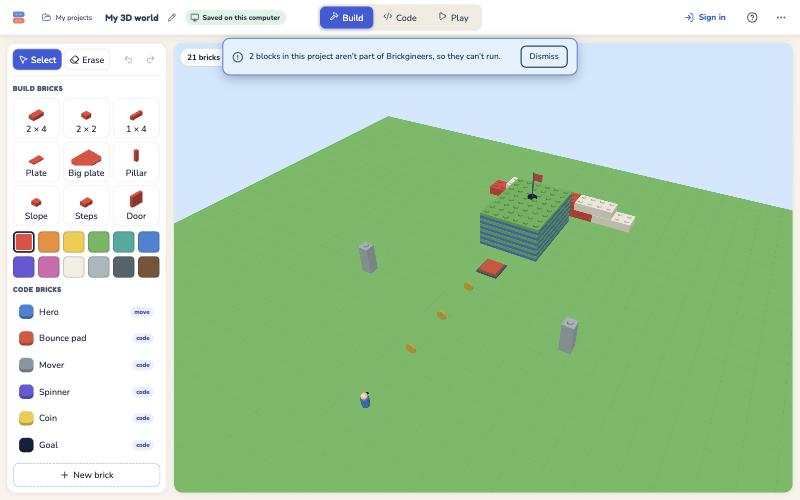 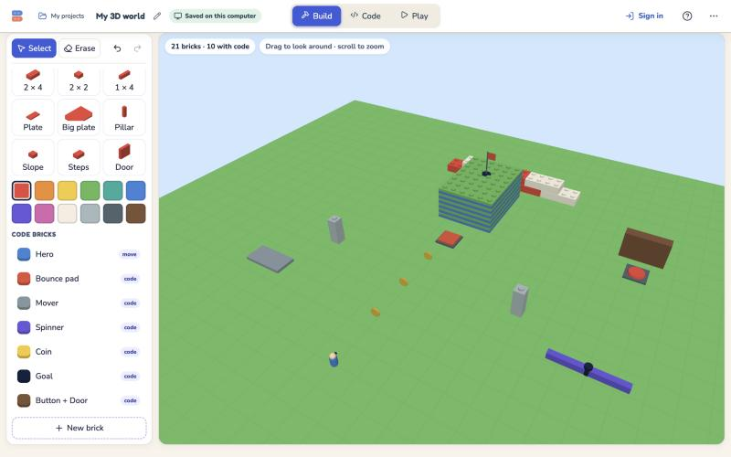 | Same layout and words. A colour row was added under the build bricks. The mock's "186 bricks" chip reads "21 bricks · 6 with code". |
| **Build**: the brick card (Sliders · Look, "Just this one / All 3 pads", launch speed, See inside) | 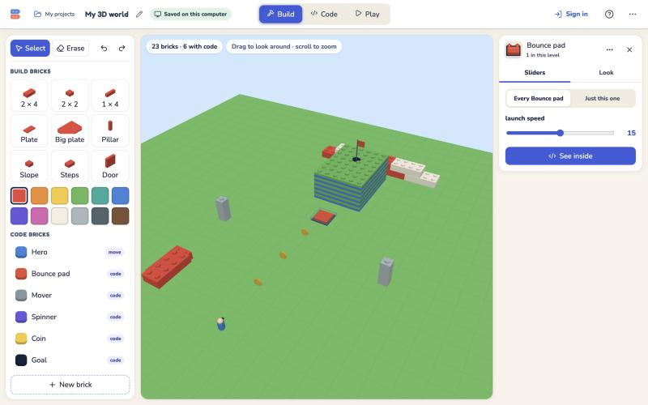 | The shell's card: "Every Bounce pad / Just this one". The mock's "squash time" slider doesn't exist (the pad has no squash). |
| **Code**: blocks on the left, the running world beside them, Restart, "Just this brick" | 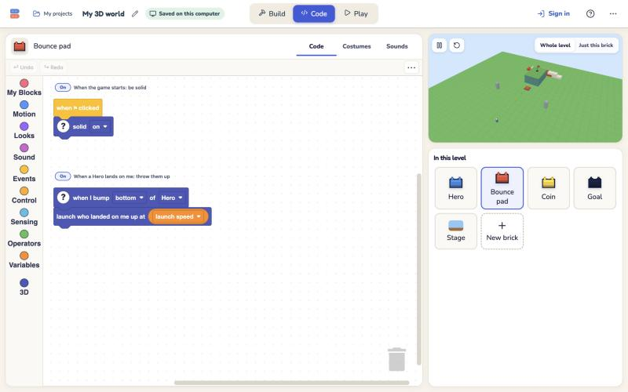 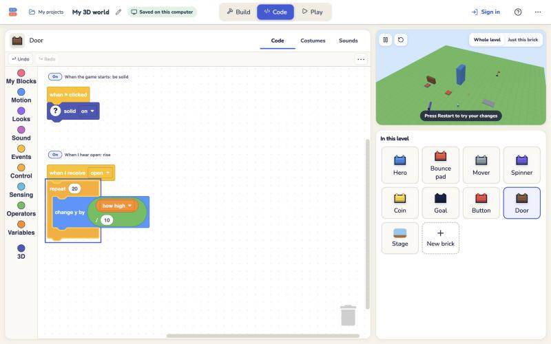 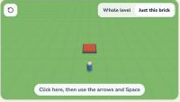 | The 2D studio's Code layout: the world at the top right, "In this level" below. |
| **Six code bricks** |  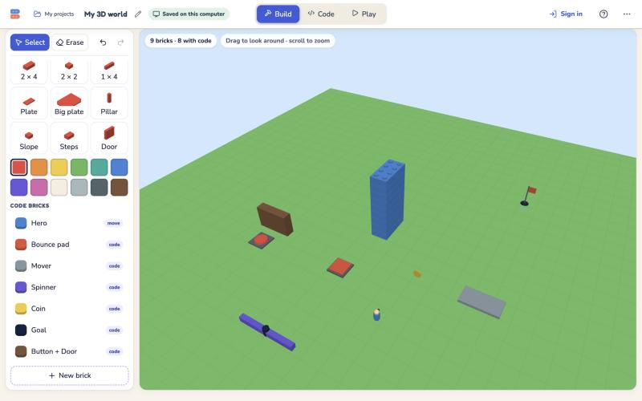 | Scripts in the table above. |
| (Play, not in the mock) | 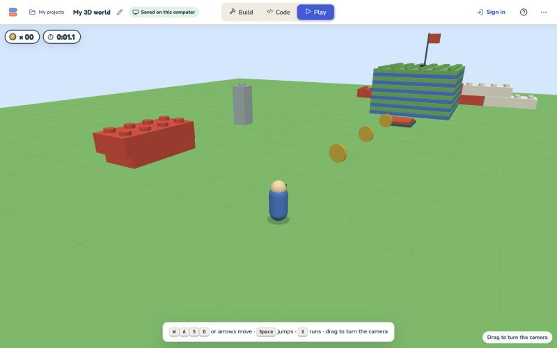 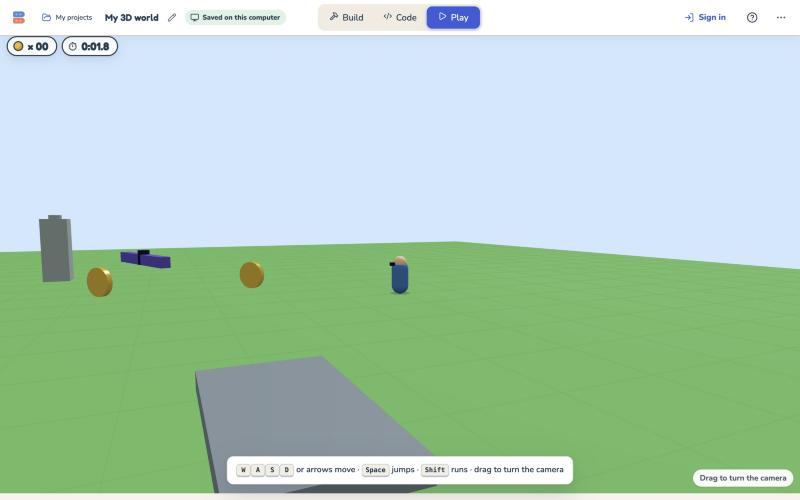 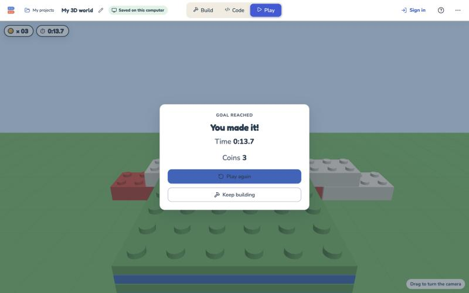 | |
| (Ways in) | 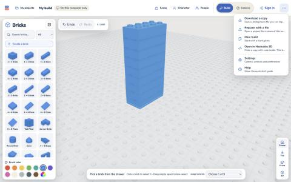 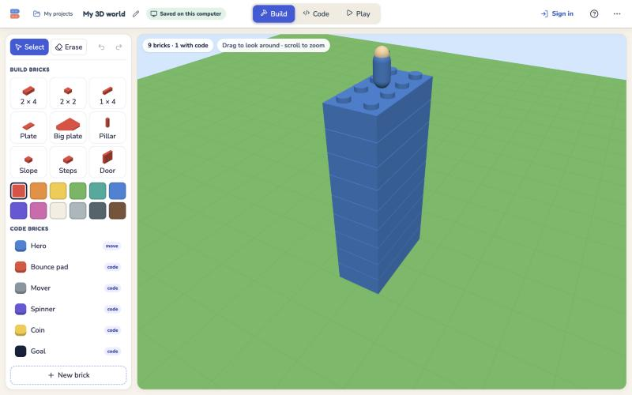 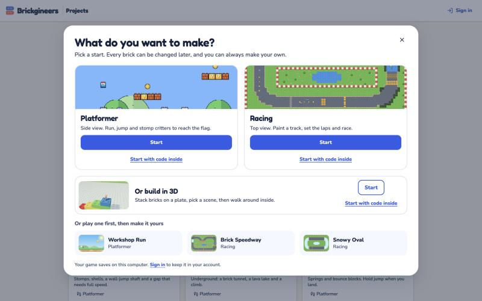 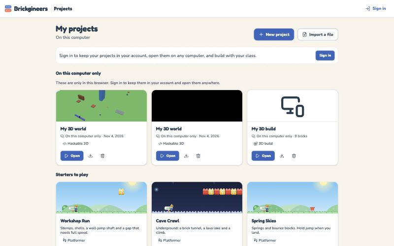 | |
| **Play together** | (none) | D3. Hidden for 3D. |
| **The Hero's sliders** | (none) | D2. The Hero's card says "Make a variable…" for now. |

## Checks

| Check | Result |
|---|---|
| `npx tsc --noEmit -p .` | Clean |
| Full app vitest | See "The full suite" below |
| Lockstep and determinism, Node / Chrome 156 / WebKit 26.5 (`node scripts/qa/lockstep/run3d.mjs`) | Identical on every tick, both modes; late joiner matches. Details below. |
| Hero feel vs classic `characterController.ts` on real Rapier, now with ledges and slopes (`feel3d.test.ts`, FEEL.md) | Matches, with the differences listed below |
| Tick and draw cost, 500 and 2,000 bricks, 6× CPU slowdown | Well inside budget on this Mac; see below |
| Real browser run: classic → Open in Hackable 3D → each code brick → live code edit → play → save → reload | Done, see below |

### The full suite

- **First run:** 3,765 passed, 21 failed and 25 expected fails, across 344 files. It ran while three helper agents, a
  browser and a Rapier benchmark were running.
  - **Twenty of the failures were 5–110 s timeouts.** These were in `BrickStudioApp`, `graphicsPause`, `room`,
    `classicKeys`, `CodeEditor.loadFailure`, `CodeEditor.sections` (the known flake), `fileRoundTrip`, `carBrick`,
    `build3d` and `perf` (the known flake).
  - **Every one of those files passed on its own afterwards:**

    | File | Tests |
    |---|---|
    | BrickStudioApp | 62 |
    | graphicsPause | 3 |
    | room | 11 |
    | classicKeys | 8 |
    | CodeEditor.loadFailure | 4 |
    | fileRoundTrip | 6 |
    | carBrick | 11 |
    | build3d | 7 |
    | perf | 4 |
    | CodeEditor.sections | 6 |

  - **One failure was real:** `platformer/boundaries.test.ts`, "imports no 3D code". The 2D chunk statically reached
    three.js through the 3D slots. It was fixed by loading them lazily, and the test now names the 3D chunk and checks
    it is only reached through `import()`.
- **Final run on the quiet machine (after every merge and fix):** 3,785 passed, 9 failed and 25 expected fails, across
  345 files. All 9 failures were in three files, and all were timeouts or follow-ons of one:

  | File | Failures | On its own afterwards |
  |---|---|---|
  | `CodeEditor.sections` (known flake) | 5 | 6 of 6 pass |
  | `BrickStudioApp` | 3 | 62 of 62 pass |
  | `CodeEditor.loadFailure` | 1 ("restoring the original…", 60 s test timeout) | See below |

  - **`CodeEditor.loadFailure` on this branch:** the whole file failed that test 2 times in 6 (77 s and 134 s), then
    passed 4 times (24–38 s). The test alone passed 3 of 3 (11–20 s).
  - **The same file on production main 32ce3e0b,** in a temporary worktree: 2 of 2 whole-file runs passed in 21 s, and
    3 of 3 runs of the test alone passed in 13–18 s.
  - **So it is a load-sensitive timeout that this branch makes a little more likely** (the whole file is a few seconds
    slower here). It is not a wrong result. **Treat it as a third known flake until it is looked at:** possibly the 3D
    menus' generator functions, which are now functions in 2D too.

### Lockstep and determinism

The setup is the spike's 1,800-tick, three-player room timeline:
- joins and leaves;
- keys and camera yaw;
- Play again at 600 and 1200;
- a live code edit at 300 (Bounce pad launch 15 → 20 studs a second);
- a live Build edit at 750.

D1 adds **one of each code brick** around the start (`harness3d.ts` `d1Design`). Over the run, the room:
- rides the Mover for 45 ticks;
- sends a Hero home once (the Spinner);
- opens the Door;
- collects the D1 Coin;
- makes 2 bounces and 94 landings.

| 500 bricks | Node | Node again | Chrome 156 | WebKit 26.5 | Late joiner at tick 907 |
|---|---|---|---|---|---|
| as scenery (D1's way) | same on all 1,800 ticks | same | same | same | same to the end (17 KB keyframe) |
| as targets (2D's way, for comparison) | same | same | same | same | same to the end (321 KB keyframe) |

Raw numbers: `docs/qa/hackable-3d/lockstep/summary.json`. The engine tests also check a rewind and a JSON keyframe
mid-ride on the Mover (`bricks3d.test.ts`).

### Tick cost, 2,000 bricks as scenery

The setup is the same harness's benchmark: two to three players, the six code bricks and the Bounce pad, 300 ticks.
Budget: 33 ms per tick.

| Engine | Tick avg | Tick p95 | Copy | Rewind 10 | Keyframe |
|---|---|---|---|---|---|
| Node 22 | 0.030 ms | 0.052 | 0.069 | 0.41 | 14.8 KB |
| Chrome 156 | 0.020 | 0.100 | 0.065 | 0.39 | 14.8 KB |
| **Chrome at 6× slowdown** | **0.20** | 1.2 | **0.57** | **2.4** | 14.8 KB |
| WebKit 26.5 | 0.027 | n/a | 0.108 | 0.43 | 14.8 KB |

At 500 bricks with 6× slowdown, a tick takes 0.35 ms. Making every brick a target instead still costs 5.6 ms a tick,
49 ms a copy and 104 ms a rewind at 2,000 bricks on the simulated Chromebook. That confirms the spike's choice of
scenery.

### Draw cost

`node scripts/qa/h3d/run-draw.mjs` runs the studio's own `World3View` drawing a running game (two Heroes, the six code
bricks) at 1280 × 720 in headless Chrome. Results are in `docs/qa/hackable-3d/perf/draw.json`.

| | Build meshes (rebuilt on each Build edit) | Tick | Frame (JS) avg / p95 | Draw calls | Triangles |
|---|---|---|---|---|---|
| 500 bricks, 1× | 12.7 ms (first build: geometry made) | 0.05 ms | 0.12 / 0.2 ms | 37 | 257 K |
| 2,000 bricks, 1× | 1.5 ms | 0.04 ms | 0.22 / 0.3 ms | 37 | 735 K |
| 500 bricks, 6× | 88.7 ms (first build, JIT) | 0.35 ms | 0.93 / 1.8 ms | 37 | 257 K |
| **2,000 bricks, 6×** | **10.5 ms** | **0.43 ms** | **1.6 / 2.6 ms** | 37 | **735 K** |

How to read this:
- **The CPU side is small.** At 6× slowdown, a frame's JavaScript is under 3 ms of the 16.7 ms budget.
- **The GPU side here means nothing for a school.** Headless Chrome on this Mac draws with the M5 Max's GPU through
  ANGLE/Metal, and `gl.finish()` added nothing measurable.
- **The risk is triangles.** At 2,000 bricks a frame is 735 K triangles, mostly studs from the classic part geometry,
  which may be a lot for a Chromebook's integrated GPU. See Risks.

### Hero feel

`docs/qa/hackable-3d/feel/FEEL.md` compares the classic `characterController.ts` on real Rapier 0.19.2 in Node, set up
as `BrickStudioScene` does, with the Hackable Hero. Both get the same keys on the same bricks.

- **Same:**
  - flat walk and jumps: the walk is within 1e-4 until the first landing, the jump arcs within 3e-7, and the jump height
    is 0.9056 for both;
  - stepping up a plate;
  - being stopped by a brick (stop points 0.007 apart);
  - walking off a brick ledge;
  - climbing slopes, a stair and stacked slopes;
  - jumping onto a brick, standing, walking and running;
  - 2- and 3-stud gaps, walking and running;
  - corners and wall slides.
- **Fixed in D1 from what it found:**
  - **A. `SNAP` 0.13 → 0.2.** The box used to fall for 0.17 s walking off a plate, and for 0.37–0.50 s in 2–3 falls
    going down a slope or stair, where the classic capsule stays grounded. After the change, all three are 0 s, as in
    the classic. Brick ledges still fall.
  - **B. The drawn Hero eases over steps of up to 0.22 (render only)**, so a slope's plate-high steps glide rather
    than pop.
- **Still different:**
  - **Slopes are plate-high steps.** The Hero climbs a slope about twice as fast as the classic (0.20 s against 0.40 s
    for a 2 × 2) and doesn't slow down.
  - **Ledges:** the box stays up about 0.2 further past a ledge than the capsule.
  - **A barely-short 4-stud jump** (Space 0.2 short) is made by the classic and missed by the Hackable Hero (FEEL.md's
    fix C, not applied).

### The real browser run

This ran in the app's browser pane (Chromium), on this worktree's dev server.

1. **Classic build:** in `/build` (guest), I placed a stack of 2 × 4 bricks (9 in all), then This project → **Open in
   Hackable 3D**.
   - It went to `/3d/hackable?draft=…`, titled "My 3D world · Hackable 3D".
   - The 9 bricks were there, with the Hero standing on top of the tower in the plate's middle.
2. **Each code brick from the drawer:** I placed the Hero (moved to the plate), a Bounce pad, a Mover, a Spinner, a
   Coin, the Goal, and a Button + Door. The chip read "9 bricks · 8 with code".
3. **A live code edit:** I double-clicked the Door, which opened its code, and changed `repeat 10` to `20` in the
   editor.
   - The world showed "Press Restart to try your changes".
   - After Restart, "open" raised the door to 4 studs; it had been 2.
4. **Play:** the camera followed the Hero and drag turned it, and the keys moved the Hero. On the starter world, I walked
   up the pad onto the deck: 3 coins, then "You made it!" with time and coins.
5. **Save and reload:** the chip read "Saved on this computer". After reloading the address, the project was identical:
   9 build bricks, the same 8 copies, the door's `repeat 20` and kit `3d`.
6. **After the copy:**
   - `/build` reopened the classic build untouched ("Opened a build with 9 bricks").
   - My projects listed both 3D worlds as "Hackable 3D", with a picture.
   - The 3D studio's This project menu has no Play together.
7. **Regression look:** `/2d/hackable?new=1` still opens the 2D Platformer studio as before.

## Deviations from the mock

- **Bounce pad:** "launch speed" is **15**, not 9, because the mock's numbers were the classic's world units and blocks
  are now in studs (15 studs/s ≈ 9.3 units/s). The mock's "bounces" counter and "squash time" slider were dropped.
- **Mover:** speed **2** studs/s (the mock's 1.5 was world units).
- **Coin:** "worth" became "spin". The Coin broadcasts "coin collected" and the Stage counts it, as the 2D Coin does,
  rather than changing a global itself. That keeps a placed Coin working in any 3D project.
- **Goal:**
  - It broadcasts **before** it speaks: a Hero still walking into the flag restarts the bump script every tick, so a
    2-second speech first would never finish.
  - It is solid, so it can be bumped.
- **Button + Door:**
  - The Button sends "open" **once** (a `pressed` variable): a Hero standing on it bumps it every tick.
  - The Door rises "how high" studs (2) over 10 steps; the mock's slider was "door rises 10".
  - The Door is placed 2½ studs behind the Button.
- **Spinner:** it touches with its turned bar, but it is not solid. Solids stay on the grid.
- **Brick card:** "Every Bounce pad / Just this one", the shell's own words. Look shows the brick's icon costume, not a
  3D preview.
- **Drawer:** a colour row is added. The Hero is listed under Code bricks so it can be moved. "+ New brick" makes a
  1 × 1 brick and opens Code.
- **Header:** there is no "Hackable 3D" pill next to the name; the tab title says it. "Play together" is hidden (D3).

## Rooms in D1, and the camera angle for D3

- **Hidden or harmless:**
  - a 3D project's This project menu has no Play together;
  - `?together=1` says "Playing Hackable 3D together is coming soon.";
  - `RoomPage` turns a guest room or class room holding a 3D project away politely, with Open it and My projects;
  - My projects and the class page offer Look inside for shared 3D projects.
- **The camera angle is already game input.** The Hero walks relative to its player's camera. `lookPlayer3d(runtime,
  player, yaw)` stores the yaw in whole degrees, on `PlayerSlot.yaw` in a room and `world.yaw3d` outside one. The Stage
  sends it only when the rounded value changes.
- **For D3:**
  - Make it a room event, `{ kind: 'look', yaw }`, next to key down and up. It is stamped, ordered and rewound like a
    key; the lockstep harness already does exactly this.
  - The Stage should send a look event only on a whole-degree change, and at most about 10 a second while dragging.
    A dragging kid would otherwise send up to 60 events a second; about 10 is plenty, because the keys' direction only
    matters when a key is down.
  - A late joiner gets yaws in the keyframe (they are in `PlayerSlot`).
  - Each screen draws its own camera from its own yaw. Other players' cameras are never drawn, only their Heroes'
    facing.
- **Room size:** Hackable rooms cap a project at 900 KB (`rooms/protocol.ts` `MAX_PROJECT_BYTES`), and a 2,000-brick
  world is about 185 KB.

## Open questions for the owner

1. **Studs mostly worked out.** One place is awkward: **heights.**
   - A brick is 3 plates, which is **0.87 studs**, and a plate is 0.29 studs. So "go to y: 1" floats a little above one
     brick, and a kid stacking by numbers gets fractions.
   - Options:
     - keep studs everywhere (now);
     - y in plates (a brick is 3), with x and z in studs;
     - y in "bricks" (a brick is 1).
   - The engine converts at the block's edge, so changing y's unit later only touches `blocks3d.ts` and the six
     bricks' numbers.
   - Speeds in studs a second read fine: a Mover at 2, a launch at 15. The Hero's sliders (D2) will be odd numbers in
     studs (walk 5.65, run 8.71, jump 8.47, gravity 25.8), unless D2 shows them as "walk 3.5" style feel numbers. That
     is a D2 decision.
2. **Should movers push Heroes?** In D1, platforms carry riders but pass through a Hero in their way (the classic
   builder has no moving parts to compare with). A Door rising into a Hero's head passes through.
3. **Slopes:** keep them as plate steps (now eased in the drawing), or give them real ramps (FEEL.md's alternative)?
4. **Should Look on a 3D brick's card offer colour and model?** Today it shows the icon costume.
5. **The landing page's "Build in 3D" card** outside the picker was not changed. Should it link "code inside" too?
6. **Open in Hackable 3D names a guest's copy "My 3D world",** not the classic build's name ("My build").

## What is not verified

- **A real school Chromebook.** The 6× CPU slowdown is a stand-in for the CPU only. The GPU cost of 735 K triangles at
  2,000 bricks on an integrated GPU is unknown. Shadows are off and there is no LOD.
- **Firefox.** Lockstep ran in Node, Chrome and WebKit only, and the studio was tried in Chromium only.
- **Touch.** D2 brings the 3D stick and Jump and Run. Until then a touch screen shows no controls in Play: Play shows
  nothing extra, and the canvas takes drags for the camera. Pinch-zoom in Build is also missing.
- **Phones and the Duo layout:** these were not looked at for 3D.
- **Signed-in saving** to the account. This was checked by unit tests only; the browser run was a guest in this
  browser.
- **The mock side by side.** It needs a claude.ai sign-in in the browser pane.
- **Big classic builds through Open in Hackable 3D:** custom parts and 96- or 128-stud plates are covered by unit tests,
  not by a browser run with a real large build.

## Risks

- **The GPU on Chromebooks**, as above. The classic builder's render groups and LOD (`buildRenderGroups.ts`) are the
  next step if a class test stutters.
- **A Build edit rebuilds all the build's meshes:** 10.5 ms at 2,000 bricks with 6× slowdown. That is fine per click,
  but dragging to paint many bricks would need incremental updates.
- **Two physics engines for a while,** Rapier in the classic and this one, until the classic retires. FEEL.md is the
  checklist to keep them alike.

## Files

- **New:**
  - `src/platformer/lab/kit3d/`: `blocks3d.ts`, `parts3d.ts`, `validate3d.ts`, `run3d.ts`, `feel3d.test.ts`;
  - `src/platformer/lab/studio/three/` (all);
  - `src/platformer/lab/studio/persist/openInHackable3d.ts`;
  - `scripts/qa/h3d/`;
  - `docs/qa/hackable-3d/{D1.md,d1/,perf/,feel/}`.
- **Changed, shared (small and additive):**
  - `core/index.ts` (the engine, plus `instantiate` on `KitEngine`);
  - `core/project.ts` (one call);
  - `kits.ts`;
  - `kitScreens.ts` (the `'3d'` entry; `screensFor` reads the table);
  - `screen/kitParts.tsx` and `StudioShell.tsx` (optional slots);
  - `store.ts` (`updateDesign`);
  - `StudioApp.tsx` (route kit, no Play together for 3D, the stage picture);
  - `core/editor/*` and `CodeEditor.tsx` (3D palette);
  - `routes2d.ts` and `routes.ts`;
  - `persist/*`, `src/projects/*`, `src/pages/{worlds,class}`, `src/shell/WorldMenu.tsx` and `AppHeader.tsx`;
  - `rooms/RoomPage.tsx`;
  - `boundaries.test.ts`.
- **For merging with the parallel lanes:** Blank 2D also adds a kit. Its `kitScreens`/`kitParts` entries and
  `KIT_ENGINES` line will sit next to these; the table shapes are unchanged apart from the optional slots.
