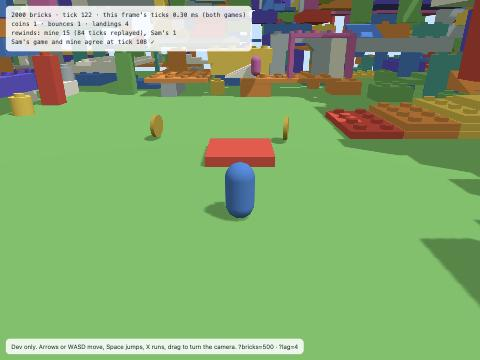

# Hackable 3D: design mock and technical spike, November 3, 2026

**Branch:** `claude/hackable-3d-spike-f89ca4`, cut at 47e6d228 (hackable rooms M1 plus the parity audit). It is committed locally and has
not been pushed or deployed.
**Mock:** https://claude.ai/artifact/GCnbm8BdUfwNdE1A18nWSW (private). It has six screens: Build, Code, the 3D block
category, the Hero's sliders, six code bricks and Play together.
**Question:** can 3D bricks and a 3D character run inside the Hackable deterministic core, so that rooms' lockstep
works without changes? Rooms' lockstep means every browser runs the same game, late inputs roll back, and
fingerprints are compared.

## The answer

**Yes, and it is cheap.** I added a small deterministic 3D extension to the Hackable core:
- stud-grid boxes;
- swept collision one axis at a time;
- the classic 3D character ported to + − × ÷, sqrt and `detmath`, with autostep and snap to ground.

It runs as a kit on the shared runtime: the same scheduler, op budget, blocks, RNG, snapshot and players. I played a
1,800-tick room in Node (twice), Chrome 156 and WebKit 26.5. The room had:
- three players joining and leaving;
- key presses and camera turns;
- two rounds of Play again;
- a live code edit and a live Build edit.

The results:
- **All four runs were identical on every tick.** This held for both fingerprints: the full text and `core/snapshot`'s
  32-bit one.
- **A late joiner who started from the JSON keyframe matched to the end.**
- **Performance at 2,000 bricks with 6× CPU slowdown in Chrome** (the stand-in for a school Chromebook):
  - a tick costs 0.17 ms;
  - a rewind copy costs 0.43 ms;
  - a 10-tick rewind costs 1.7 ms;
  - the keyframe is 6.6 KB.

  The budget is 33 ms per tick.
- **The ported character matches the classic controller (`src/brick/characterController.ts`) to within 1e-6 units**
  over 150 ticks of walking and three jumps.

What makes it cheap is one decision: **plain build bricks are not targets.**
- They are scenery, the classic builder's own brick list. They are indexed once, shared by every copy of the world, and
  never copied, hashed or sent.
- Only coded bricks, and Heroes, are targets.
- Making every build brick a target, the way 2D makes every grid cell a target, costs 52 ms per copy, 140 ms per rewind
  and a 1.1 MB keyframe on the same simulated Chromebook. That would break rollback.

**Recommendation:** build Hackable 3D as `KIT_ENGINES['3d']` on this extension, with three.js used only to draw. Do not
use Rapier, and do not build a separate engine. The plan below gets to playable code bricks in about 2 weeks and to
rooms about 2 weeks after that.



## What was built

Nothing in `core/`, `src/brick/`, the rooms UI, the Worker or the landing was changed. Every file is new.

| File | What it is |
|---|---|
| `src/platformer/lab/kit3d/contracts3d.ts` | What a 3D game adds to the core's types: `Target3` (a target with `z` and `body3`), `SceneryBrick` (the classic `BrickInstance`), `LevelDesign3` (`kit: '3d'` plus `scenery3d`), `PlayerSlot3.yaw`, `World3.bumps3d`. These are type intersections, so core files did not change. |
| `src/platformer/lab/kit3d/physics3d.ts` | The physics. Classic parts become boxes. Scenery has a uniform-grid index, built once per build and cached on the array. Coded solids are rebuilt each step. The sweep runs x, z, then y. The character runs two 60 Hz substeps per tick. Bump, land and leave hats fire on both sides. Also the 3D blocks. |
| `src/platformer/lab/kit3d/engine3d.ts` | `engine3d`, a `KitEngine` with the same lifecycle as the Platformer's and `physicsStep3d` after each tick. Also `instantiate3d`, `addPlayer3d` (wraps `core/players.addPlayer`) and `lookPlayer3d`. |
| `src/platformer/lab/kit3d/sample3d.ts` | The sample project: *n* classic bricks (a plate ramp, a deck, then a seeded scatter of stacked parts), the Hero with five sliders, a coded Bounce pad and two coded Coins. |
| `src/platformer/lab/kit3d/physics3d.test.ts` | 11 tests: standing, walking along the camera yaw, jump height, one air jump, autostep onto a plate but not a brick, Bounce pad, Coin, **classic feel parity**, JSON rejoin, rewind, and both scenery modes. |
| `scripts/qa/lockstep/harness3d.ts`, `run3d.mjs` | The 3D lockstep test and the benchmark (Node, Chrome, Chrome at 6× slowdown, WebKit). Results go to `docs/qa/hackable-3d/lockstep/summary.json`. They are separate from `run.mjs`, so the rooms lane's file was not touched. |
| `dev/hackable-3d-spike.html`, `src/platformer/lab/kit3d/spike/main.ts` | A **dev-only** page at `/dev/hackable-3d-spike.html`. It is served by the Vite dev server only; the production build's only entry is `index.html`. Details below the table. |

About the dev page:
- It runs two browsers in one page, each with its own `HackableTimeline` from `rooms/timeline.ts`. Each browser
  receives the other's events 4 ticks late, so both rewind constantly.
- The HUD checks that the two games agree on a settled tick.
- You play Maya; Sam is a seeded bot.
- Bricks are drawn with the classic `createBrickGeometry` (read only), instanced.
- Options: `?bricks=500`, `?lag=4`.

To run it:

```bash
PATH=/opt/homebrew/opt/node@22/bin:$PATH npx vitest run src/platformer/lab/kit3d
```

```bash
PATH=/opt/homebrew/opt/node@22/bin:$PATH node scripts/qa/lockstep/run3d.mjs
```

The second command takes about 3 minutes with the benchmark; add `--no-bench` to skip it. `tsc --noEmit -p .` is clean.

## Lockstep result

**The timeline** (`timeline3d`, 1,800 ticks = 1 minute, 1,857 events):
- Maya plays from the start and leaves at 1500.
- Sam joins at 100.
- Lee joins at 400 and leaves at 1000.
- Each player first walks straight ahead onto the Bounce pad, then plays randomly: keys plus camera yaw.
- Play again at 600 and 1200.
- At 300, the Bounce pad's code is edited: launch 9 → 12.
- At 750, a brick is dropped into the build.

**What the run exercised:** 2 bounces, 3 coins and 94 landings. The coins move to random places using the seeded RNG.

| 500 bricks | Node | Node again | Chrome 156 | WebKit 26.5 | Late joiner at tick 907 |
|---|---|---|---|---|---|
| as scenery (recommended) | same on all 1,800 ticks | same | same | same | same to the end (8.6 KB keyframe) |
| as targets (2D's way) | same | same | same | same | same to the end (297 KB keyframe) |

**What determinism needed:**
- **No `Math.sin`, `cos`, `atan2`, `exp` or `hypot`.**
  - The damping factors `exp(-rate·dt)` are computed once with `detmath.exp`.
  - Facing uses `atan2Deg`.
  - Camera-relative movement uses `sinCosDeg`.
  - Speed uses `sqrt(x² + z²)`.
- **Ties between equal faces go to the earliest solid:** scenery first, then world order.
- **Faces within 1e-9 count as touching.** Positions such as 0.62·k are not integers, and without this tolerance a
  body could clip a face it is resting against by a few ulps.
- **Camera yaw is input.** The character moves relative to its player's camera, so the yaw is a room event: whole
  degrees, stored on `PlayerSlot.yaw`. Without it, every browser would move other players' Heroes along the wrong axis.

**Feel parity** (test "walks and jumps on flat ground within a micrometre…"):
- On a flat floor I ran the classic `stepCharacterMotion` with Rapier's part (stop at the floor, snap) done by hand.
- I compared it against the Hackable Hero over 150 ticks: walk forward, three jumps, stop.
- The worst difference in position was under 1e-6 units.
- Jump height is 0.906, as in the classic. Both integrate at 60 Hz from the jump substep.

## Cost

These are from `summary.json`. Each run is two to three players running around for 300 ticks:
- "copy" is the rewind copy that rooms keep every 4 ticks;
- "rewind 10" restores a copy from 12 ticks back and replays 10 ticks;
- "print" is `worldFingerprint`;
- "play" is instantiate plus green flag plus one tick, including building the scenery index.

WebKit's timer has 1 ms resolution, so its p95 column means nothing.

| Engine | Bricks | Mode | Targets | Play ms | Tick avg | Tick p95 | Copy | Rewind 10 | Print | Keyframe KB |
|---|---|---|---|---|---|---|---|---|---|---|
| Node 22 | 500 | scenery | 4 | 1.1 | 0.025 | 0.053 | 0.074 | 0.41 | 0.038 | 6.6 |
| Node 22 | 2,000 | scenery | 4 | 1.4 | 0.019 | 0.039 | 0.074 | 0.27 | 0.047 | 6.6 |
| Node 22 | 500 | targets | 504 | 2.5 | 0.54 | 0.96 | 2.9 | 8.3 | 3.2 | 288 |
| Node 22 | 2,000 | targets | 2,004 | 11.0 | 1.97 | 4.0 | 12.0 | 38.7 | 13.7 | 1,137 |
| Chrome | 500 | scenery | 4 | 6.4 | 0.039 | 0.1 | 0.039 | 0.41 | 0.051 | 6.6 |
| Chrome | 2,000 | scenery | 4 | 2.5 | 0.020 | 0.1 | 0.036 | 0.26 | 0.046 | 6.6 |
| Chrome | 500 | targets | 504 | 3.7 | 0.28 | 0.5 | 2.1 | 5.9 | 3.1 | 288 |
| Chrome | 2,000 | targets | 2,004 | 6.5 | 0.98 | 1.1 | 8.1 | 20.5 | 12.3 | 1,137 |
| **Chrome 6× slowdown** | 500 | scenery | 4 | 40.1 | 0.22 | 1.3 | 0.35 | 3.0 | 0.38 | 6.6 |
| **Chrome 6× slowdown** | **2,000** | **scenery** | 4 | 24.3 | **0.17** | 1.2 | **0.43** | **1.7** | 0.36 | **6.6** |
| Chrome 6× slowdown | 500 | targets | 504 | 26.0 | 2.4 | 3.6 | 14.8 | 41.7 | 22.5 | 288 |
| Chrome 6× slowdown | 2,000 | targets | 2,004 | 47.3 | 6.5 | 8.7 | **52.3** | **139.7** | 80.0 | **1,137** |
| WebKit 26.5 | 500 | scenery | 4 | 5 | 0.023 | – | 0.081 | 0.29 | 0.013 | 6.6 |
| WebKit 26.5 | 2,000 | scenery | 4 | 1 | 0.013 | – | 0.068 | 0.14 | 0.017 | 6.6 |
| WebKit 26.5 | 500 | targets | 504 | 4 | 0.17 | – | 2.2 | 3.9 | 1.0 | 288 |
| WebKit 26.5 | 2,000 | targets | 2,004 | 4 | 0.34 | – | 8.1 | 14.7 | 3.8 | 1,137 |

What the numbers show:
- **With scenery, the cost of a tick, a copy, a rewind and a keyframe does not grow with build size.** Only Play
  start grows, because it builds the index once (24–40 ms at 6× slowdown, mostly JIT warm-up).
- **With targets, a 10-tick rewind takes 140 ms on a simulated Chromebook,** which is more than four ticks' budget.
  The 1.1 MB keyframe is also over the classic room's 600 KB keyframe cap.

## Architecture recommendation

**One runtime, a 3D kit.** `KIT_ENGINES['3d'] = engine3d`:
- the Scratch primitives plus the Platformer's, with the 3D overrides on top;
- the Platformer's lifecycle (looks, sound, "every tick");
- `physicsStep3d` in `afterTick`.

The scheduler, op budget, values, RNG, clones, players, snapshot, timeline, editor, save format and rooms are all
shared.

**Two kinds of bricks.** This is the place, tune and open-code layering in 3D:
- **Build bricks** are the classic builder's `BrickInstance` list: part, x/z in studs, y in plates, rotation and colour.
  - They are stored on the design as `scenery3d`.
  - On Play they become boxes in a grid index cached per list.
  - They are project data, like the 2D `tiles` and `bricks`: never copied, never in the fingerprint, never in a
    keyframe.
  - A Build edit replaces the list, so the index is rebuilt (O(n), about a millisecond), and a rewind keeps the old
    list.
- **Code bricks** are ordinary Hackable bricks whose copies are targets with `z` and `body3` (a box, speeds,
  solid/gravity, on ground). Kids open them, remix them and give them Sliders exactly as in 2D.
- **"Give this brick code"** (See inside on a plain brick, or + New brick) moves one build brick out of `scenery3d` into
  a code brick. A world of 2,000 bricks with 20 coded ones costs like a world of 20.

**The Hero is the classic 3D character, run by the engine, with sliders** (D2).
- Walk 3.5, run 5.4, jump 5.25, gravity 16 and 1 air jump are the Hero brick's `showInBuild` variables. The controller
  reads them every substep, so the brick card's Sliders and live edits in a room just work.
- Kids' own scripts on the Hero (when I land, when I bump) run alongside it.
- Opening the walking and jumping themselves as blocks is D4. That matches the earlier mock's order: code bricks first,
  character sliders now, character code last.

**Collision:**
- axis-aligned boxes on the stud grid, swept one axis at a time;
- autostep 0.22 and snap 0.13, the classic's Rapier settings;
- the classic capsule (radius 0.18, half height 0.18) as a 0.36 × 0.72 × 0.36 box.

How classic parts become boxes:

| Part | Collision |
|---|---|
| Bricks, plates, round parts, cones, windows | Their footprint box |
| Corners | Two boxes |
| Doors and arches | Frame boxes, so you can walk through |
| Stairs | One box per step |
| Slopes | Plate-high steps, climbed by autostep |
| Overhang wedges | A full box |

Coded solids bump on six sides. The bump hat's SIDE menu gains front and back.

**Input:** keys plus camera yaw, in whole degrees, as a room event. Physics runs at 60 Hz, two substeps inside each
30-tick-per-second core tick, so the controller's numbers mean what they mean in the classic.

**Drawing:** three.js only reads the world. Reuse the classic part geometry and its instancing and render-group code
(`src/brick/geometry.ts`, `buildRenderGroups.ts`). Interpolate between ticks for 60 fps; the spike page does not, so it
looks a little stepped.

## Alternatives I rejected

1. **Rapier in lockstep.**
   - **The current build:** the live builder uses `@dimforge/rapier3d-compat` 0.19.2, through `@react-three/rapier`
     2.2.0. That is Rapier's standard WASM build. It is not the enhanced-determinism one, so it is not promised to be
     bit-identical across browsers.
   - **A deterministic option exists:** Dimforge publishes `rapier3d-deterministic` builds. Lockstep with it is
     realistic in principle. **I did not test it.**
   - **Why I rejected it anyway:**
     - its state lives outside `World`, so every rewind needs a Rapier snapshot and restore, and every fingerprint and
       keyframe needs an opaque blob that grows with the collider count;
     - every block that changes a body (solid, speeds, go to, show/hide, clones) would have to be mirrored into Rapier
       each tick;
     - the character controller layer is game code above the solver;
     - when two browsers disagree, the difference is inside WASM, where we can't see it.

     The core's own physics is 660 lines, already deterministic, and inspectable by kids, since it is the same model as
     the 2D Platformer's.
2. **Every build brick as a target** (the 2D grid way). This was measured above: at 2,000 bricks, a 140 ms rewind and a
   1.1 MB keyframe on a simulated Chromebook. Rejected.
3. **Running the game on the server.** The reasons are the ones in `docs/qa/hackable-rooms/README.md`: CPU cost per room,
   bandwidth, and your own Hero still needing prediction.
4. **A separate 3D engine,** for example a fork of the classic 3D builder's runtime. That would break the one-runtime
   direction and lose the blocks, editor, save format, rooms and fingerprints.
5. **Fixed-point maths.** It is not needed: floats with `detmath` agree across V8, JavaScriptCore and Node. It stays as
   a fallback if a future engine disagrees.

## What the 3D kit descriptor needs

**In core (`contracts.ts`, done through the integrator):**
- `Target.z?` and `Target.body3?`;
- `World.bumps3d?`;
- `PlayerSlot.yaw?`;
- `LevelDesign.scenery3d?` (or `build?`), and `BrickDef.shape3d?` (the box and the look);
- `snapshot.ts` needs nothing, because it walks every field. One exception: if the scenery ever moves from `design`
  onto `World`, add it to the excluded keys next to `tiles` in `copyWorld`, `worldToJson` and `worldFingerprint`.

**New opcodes** (no new hats):
- `kit3d_gotoxyz`, `kit3d_changez`, `kit3d_zposition` and `kit3d_launchlanders`;
- the Platformer's speed blocks gain `z` in their AXIS menu;
- `sensing_touchingobject` becomes box overlap in 3D.

The spike reuses `platformer_whenbump`, `platformer_whenland`, `platformer_whenleaveground` and `platformer_everytick`.

**`KIT_ENGINES['3d'] = engine3d`** in `core/index.ts`, and `KITS['3d'].ready = true` once the screens land.

**`validateDesign` for kit 3d:**
- copies have a finite `z`;
- `scenery3d` has at most 2,000 bricks (the classic `BRICK_STUDIO_MAX_BRICKS`);
- part ids are known: the design's custom parts are registered from the design, not from the global
  `BRICK_PART_MAP`, so every browser builds the same boxes;
- coordinates are within 0..64 studs and 0..1024 plates;
- `shape3d` sizes are positive.

**`kitScreens` gets a `'3d'` entry** (`ScreensKit` gains `'3d'`, and `screensFor` returns it):
- `starter()`: a Hackable 3D starter with the Hero, a Bounce pad, two Coins, a Goal and a small build;
- `playerBrickId: 'brick_hero3d'`;
- `drawer`: categories Build bricks (classic parts and colours) and Code bricks (the six templates); "+ New brick" adds
  a code brick;
- `codeStarts`: bounce-pad, mover, spinner, coin, goal, button-door;
- `powers: false` and `testRoom: false` for D1, since power files already carry a `game` field for later;
- `toolbox`: a `threeD: true` flag for the "3D" category (suggested colour `#5C6BC0`, distinct from Platformer
  `#2BB3A3` and Racing `#E8553E`). Hide `platformer_setmover`, `platformer_moveuntilhit`, `platformer_hitsomething`,
  `platformer_tellhit`, `platformer_setonground` and the 2D-only Looks effects;
- `background`: a new `'3d'` value, where the Stage slot renders the three.js scene;
- `copy`: "My 3D world", "Hero", and the controls line "Arrows or WASD move, Space jumps, X runs, drag to look".

**`kitParts.tsx` slots:**
- a 3D Stage (a three.js view of the running world, with interpolation and a follow camera);
- a 3D Build canvas. Reuse the classic placement helpers as pure functions: `surfacePlacement`, `buildInput`,
  `supportHeightForFootprint`;
- 3D touch controls: a stick plus Jump and Run.

## How existing 3D builds would open

The plan is **"Open in Hackable 3D", which makes a copy and leaves the original alone.** The classic builder stays
until parity, per the identity doc.

What happens to each part of a classic document (`BrickStudioDocument`, schema v2/v3):
- `bricks` → `scenery3d`, field for field (partId, x, y, z, rotation, colour). Coordinates are already the stud and
  plate grid that the index uses.
- `customParts` are registered for that design. Their template kinds map onto the same box rules: solid, slope, stairs,
  door and so on.
- The Hero is placed at the plate centre on top of whatever is there, using `supportHeightForFootprint`.
- The environment and character appearance carry over as look settings.

Because build bricks stay `BrickInstance`s, a Hackable 3D build can be exported back to classic.

Differences kids might notice:
- no collider insets;
- slopes are steps, not ramps;
- round parts and cones collide as their footprint;
- arch chamfers are ignored.

None of these change which spaces you can reach.

## Risks

- **Chromebook performance: drawing, not physics.**
  - Physics and rollback use under 2 ms per tick, even with rewinds, at 6× slowdown.
  - Drawing 2,000 bricks with shadows is the risk. The classic builder already draws up to 2,000 with instancing and
    render groups, so reuse that path rather than the spike's plain instancing.
  - Rewinds don't redraw.
  - Measure on a real school Chromebook in D1.
- **Feel compared with the classic character.**
  - The box doesn't round off ledges the way the capsule does; autostep and snap cover most cases.
  - Slopes feel stepped.
  - Input is sampled at 30 Hz, but the jump buffer (0.15 s) covers that.
  - Camera yaw is rounded to 1°.
  - Without render interpolation, motion looks stepped (D2 adds it).
  - The parity test covers flat ground only; ledges and slopes need a side-by-side class check.
- **Movers don't carry riders yet.** A Hero standing on a moving coded solid should move with it: one rule in the
  physics step, needed for the Mover brick in D1.
- **Spinners:** boxes don't rotate. A Spinner either uses "touching" (as in the mock) or collides with its quarter-turn
  box.
- **Remaining determinism traps:**
  - any new 3D block that needs trig (point towards, distance with z) must use `detmath`;
  - Scratch's `fencePosition` clamps x/y to `world.bounds` by costume, so it needs a 3D version (or none) for 3D
    targets;
  - Firefox is untested, as in rooms M0.
- **Two physics engines for a while:** Rapier in the classic builder and this one in Hackable 3D, until the classic
  retires.

## Phased plan

| Phase | What | Size |
|---|---|---|
| **D0: spike** | This document, the prototype, the lockstep test and the mock | done |
| **D1: code bricks in 3D (solo)** | Promote `kit3d` into core through the integrator: contracts fields, `KIT_ENGINES['3d']`, validate and save. Add the `kitScreens['3d']` entry and its slots: the 3D Stage, Build on the plate, the six code-brick templates and the 3D toolbox category with its Blockly definitions. Riders on movers. "Open in Hackable 3D" for classic builds. The Hero has the classic numbers, not yet sliders. | 1.5–2 weeks |
| **D2: character sliders** | The Hero's Sliders card (walk, run, jump, gravity, air jumps), with "back to the classic feel". Render interpolation. Touch controls. Side-by-side feel QA against the classic, with ledges, slopes and stairs. | 3–5 days |
| **D3: rooms** | A 3D room on the existing `RoomCore` and `HackableTimeline`: the `look` event, keyframes, the Play together button, class rooms, M2's roles and live edits. Add `run3d.mjs` to CI. Firefox. | about 1 week (M1's code does most of it) |
| **D4: character code** | "move like the 3D Hero" as an open block, then the controller as blocks or a power. Per-player Hero mods follow the rooms decisions. | 1–2 weeks, after class feedback |

## Decisions for the owner

1. **Units on blocks:** the classic world units, as in the spike (walk 3.5, a stud is 0.62), or studs and plates (a
   2 × 4 brick is 2 by 4)?
   - The engine can convert exactly either way.
   - I lean toward studs for positions, since kids see studs, and the classic numbers for speeds, since those are on
     the Hero's sliders.
2. **Are Heroes solid to each other in rooms?** In the spike they are not, as in 2D.
3. **The 3D category's colour and name:** "3D" or "World"?
