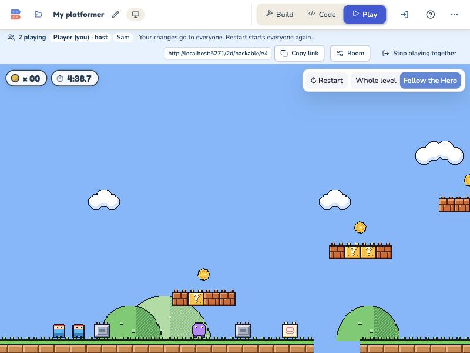
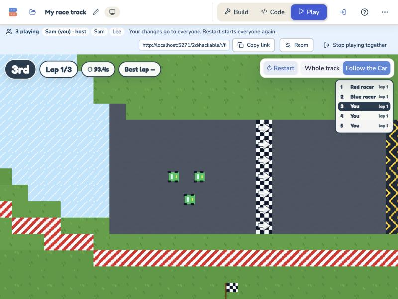
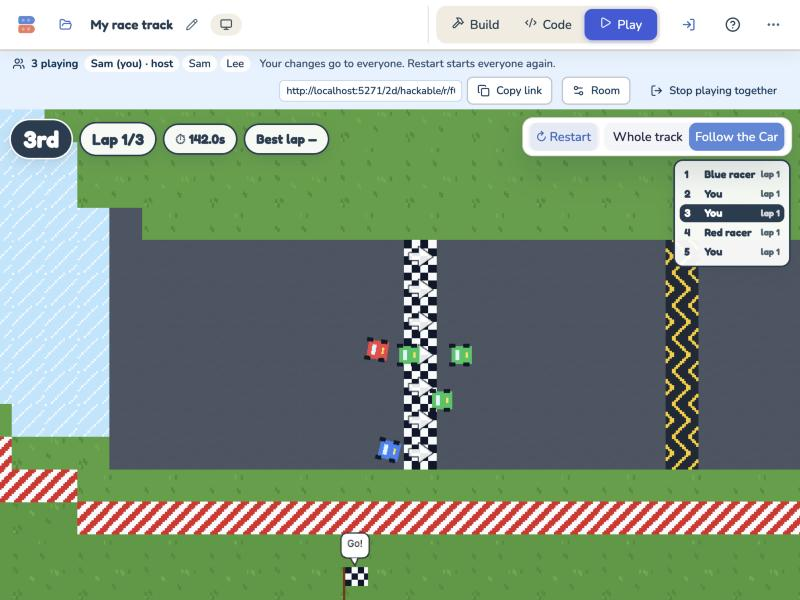
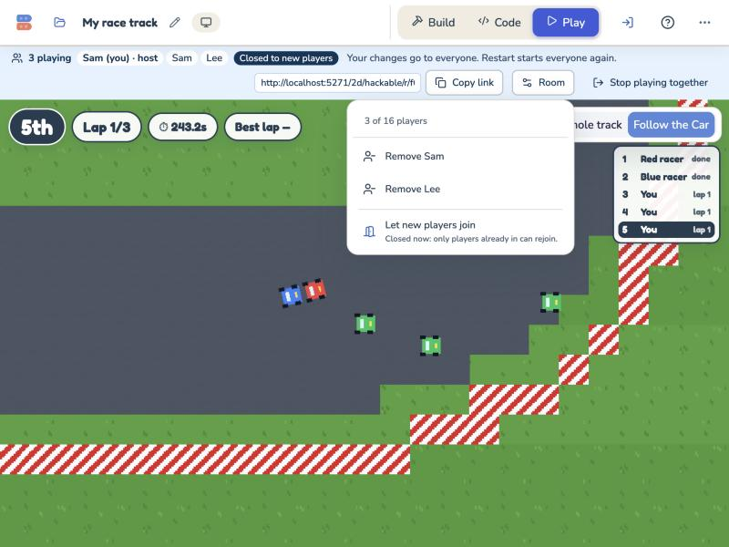

# Hackable integration: rooms ship + parity A, November 3, 2026

One branch with both of the day's Hackable lanes, the two loose ends Parity A left for rooms, and every check run
together. The lanes:

- **Ship rooms** ([`../hackable-rooms/SHIP.md`](../hackable-rooms/SHIP.md)): Play together from My projects, the
  class page and the invite sheet; host controls; a 30 s reconnect.
- **Parity A** ([`../parity-2026-11-03/A.md`](../parity-2026-11-03/A.md)): classic rules and feel in the Hackable
  Platformer and Racing.

**Branch:** `claude/hackable-int-c541e7`, cut from `claude/ship-rooms-868d57` (095227cd). It is committed locally
only: nothing is pushed, PR'd or deployed. It is 26 commits ahead of main `0a7efbd` and 0 behind, so it is ready for a
PR against main.

## Commits on top of ship-rooms

| Commit | What |
|---|---|
| `94f0b317` | **Merge** `claude/parity-a-d30e0c` (58c232a5), a merge commit with no rebase. No conflicts; the lanes share no files. |
| `d66cdb89` | **Merge** main `0a7efbd`. No file changes: main's tree is the same as `c70d457`, the base of both lanes. |
| `f0d11fae` | **Fix (a):** room Cars start on a starting grid, side by side. |
| `19b390db` | **Fix (b):** Shift runs, through the room allowlist (client and Worker) and the Hero. |
| this one | This record and its screenshots. |

After the merge, `tsc` (app and Worker) was clean with nothing to resolve. The only places the two lanes meet at run
time are where players spawn (fix a), the key allowlist (fix b), and the screens' broadcast listeners (finding 1).

## What I fixed

### (a) Car grid: `f0d11fae`

**Before:** each room player's Car spawned 20 steps further along x than the last. On the beginner track that is
straight down the race line, and with Parity A's bumping, player 1 rammed player 2 at "go".

**Now, in Racing:** a joining Car takes the first clear slot of classic Racing's grid
(`packages/platformer-core/src/engine/car.ts` `gridSpots`):

- Cars go two by two behind the painted Car: 1.6 bricks between rows, and the second Car of each row 1.4 bricks to
  the right and 0.6 back.
- Slot 0 is the painted Car (player 1 keeps it, as before).
- Slots are measured along the way the painted Car points, using detmath's sin/cos.

A slot is **clear** when the new Car would touch no other sprite there (the bump radius, `racerRadius`, now exported
from `core/race.ts`). Grid cells don't count.

- On the beginner track, slot 3 is 10 steps from a parked Computer racer, so the fourth player takes slot 4.
- A late joiner mid-race gets the front slots, which are free again by then.

The slot depends only on the shared world, so every browser picks the same one. The Platformer is unchanged: Heroes
still start 20 steps apart along x.

**Code:**

- `core/players.ts`: `gridSlot`, `clearGridSlot`, and `addPlayer(…, kit)`.
- `rooms/game.ts` passes `designKit(design)`. The lockstep harness passes its kit too.

**Tests (`core/players.test.ts`):**

- the slot geometry, pointing right and pointing up;
- six players on the beginner track: each Car on road, clear of every other racer, none in front of the painted Car;
- players 1 and 2 both floor it for 6 s and never touch;
- a parked Computer racer's slot is skipped;
- two games joining in the same order, before and during the race, land on the same spots with the same fingerprint;
- the Platformer still uses x + 20.

### (b) Shift to run: `19b390db`

Parity A left Shift undone because of rooms, so I finished it. `shift` is now a game key everywhere a key passes:

- **Room allowlist:** `rooms/protocol.ts` `isGameKey`. The Worker's `HackableRoom` validates through the same
  `roomCore`, so the client and the Worker agree.
- **Stage key map:** Shift on either side becomes `shift` (`studio/stage/keys.ts`). In `core/sensing.ts`,
  `SPECIAL_KEYS` gains `shift`, and key code 16 maps to it.
- **The code editor's key menu** (`core/editor/context.ts` `DEFAULT_KEYS`). Without it, Blockly drops a `shift` field
  when the Hero opens in the editor. I checked this by taking the entry out: the round-trip test failed.
- **The built-in Hero** reads Z, J or Shift for run. The hint, the Play help and the run-speed slider's hint say so,
  and `HERO_KEYS` has `shift`.

An untouched saved Hero still upgrades to today's built-in Hero, so it gets Shift too. Parity A's Hero was never
shipped, so no fingerprint needed adding. The touch Run button still presses `z`.

**Tests:**

- `classicKeys.test.ts`: Shift runs exactly like Z. In a room, one player's Shift runs only their own Hero. The Hero's
  shift blocks survive the editor.
- `rooms/room.test.ts`: the room core orders `shift` and still refuses `Shift` and `shift left`.
- Worker `hackableRoom.test.ts`: a guest's Shift down and up reach everyone.
- `stage/keys.test.ts`, plus the hint texts in `PlayFeedback.test.tsx` and `heroBrick.test.ts`.

## Checks (all on `19b390db`)

| Check | Result |
|---|---|
| `npx tsc -p tsconfig.app.json --noEmit` | Clean |
| Worker `npm run typecheck` (src and tests) | Clean |
| App `npx vitest run` (full suite) | 336 files: 3,640 passed, 25 expected to fail, 3 failed. All 3 are the known load flakes and pass alone: `core/perf.test.ts` timed out at 5 s (alone: 4/4 passed); `CodeEditor.sections.test.tsx` timed out at 60 s, and its next test then failed to find "How I move" (alone: 6/6 passed). |
| Worker `npm test` | 14 files, 263 passed |
| Hero feel harness (`npx vitest run src/platformer/lab/feel`) | 64 passed, 25 expected to fail. The regenerated `docs/qa/code-lab-core/FEEL.md` is byte-identical: **25 of 25** inside tolerance. `RACE_FEEL.md` is also unchanged. |
| `node scripts/qa/lockstep/run.mjs --strict-rejoin` | All 4 timelines (Platformer and Racing, solo and room) are the same on all 1800 ticks in Node v26.8.2 (twice), Chrome 156 and WebKit 26.5. The late joiner at tick 900 matches to the end. Race room: 1439 events, now with the grid. |

The Racing feel writer's path-with-a-space failure from SHIP.md is gone (Parity A fixed it in `8b540ba3`).

## Browser check

**Setup:**

- A local Worker: `wrangler dev --local` on 8787, with fresh state in the scratchpad.
- Vite for this worktree on 5271.
- The in-app browser, one tab per player. Tabs share storage, so before each guest tab loaded I hid the owner token and
  gave the tab its own client key, then restored the host's. All tabs showing "Sam" as a name is the shared saved
  guest name, a test artifact.

### Platformer, two tabs (host in the studio, Sam on the join page)

- **Shift in the room:** Sam held Shift. The key reached both tabs as player 2's `["right arrow", "shift"]`, which
  means the local Worker accepted it. Sam's Hero had `running = 1`, the host's had 0. On release, both went back to 0.
- **Ouch timing and respawn:** Sam ran into the Walker at x 185. In the host's view:
  - he stopped for 0.5 s;
  - he popped (ghost 40 → 100, hidden);
  - he was back at the start about 2.5 s after the hurt (tick 3629 → 3701);
  - he blinked (ghost 70) for about 2 s.
- **Pit:** Sam jumped on, past the Bounce block, and fell into the pit at x 344–359. His y went to −30, below the
  level. He hurt, popped, and was back at the start (80, 24) blinking about 2.5 s later.
- **Timer:** the HUD shows the coin counter and the timer.
- **"Ouch!" toast:** it shows on a screen only when that screen started listening after the room's last rebuild. See
  finding 1.
- **Fingerprints:** identical in both tabs at ticks 8072–8104. 0 resyncs in either tab.
- **Reconnect:** the background tab dropped its socket twice by itself. Each time it came back as player 2 (three extra
  `connect` lines in the Worker log), with 0 resyncs.

### Racing, three tabs (host, Sam, Lee)

- **Grid (fix a), after Restart, identical in all three tabs:**
  - player 1 on the painted spot (296, 136);
  - Sam in slot 1 beside it (286.4, 113.6);
  - Lee in slot 2 behind (270.4, 136);
  - the Computer racers untouched at (264, 168) and (264, 104).
- **At "go"**, all three held W. The closest two room Cars ever got was **24.4 px** (they touch at 11). Positions were
  identical in all tabs at tick 4393; they had kept formation.
- **Bumping:** after another Restart, only Lee drove. Player 1 pressed nothing and was shoved from x 296 to 477. Sam's
  Car stayed in its slot. Tabs matched.
- **Laps and standings:**
  - the Computer racers finished their laps;
  - the Starter said "Results: 1. Red racer 2. Blue racer" in every tab;
  - the live standings updated, and the place, lap, race clock and best lap showed.
  - Two problems in the race HUD: see findings 1 and 2.
- **Fingerprints:** identical in all three tabs at ticks 5232–5264, and again at 10272–10288, after the remove, rejoin
  and reconnect. 0 resyncs all session; 0–2 rewinds per tab, which are normal for late events.
- **Host controls:**
  - **Close:** the Worker reported `closed: true`, and Sam's tab showed "Closed to new players".
  - **Remove Lee:** the browser pane dismisses native `confirm()`, so for the test I stubbed it to return OK in the
    host tab. Lee's Car went for everyone, the host's bar showed `banned: 1`, and Lee's tab said "The host removed you
    from this room."
  - **Let removed players back in, then Let new players join:** `banned: 0`, `closed: false`. Lee rejoined as player
    3 and, mid-race, took the free front slot (296, 136).
- **Reconnect:** Sam held W and I closed his socket.
  - The host saw "Sam · reconnecting", and Sam's held keys were released at once (player 2's keys `[]`).
  - Sam's link reconnected by itself as player 2, with the same Car at the same spot (858.9, 116.9) in both tabs.
- **Console:** no errors in any of the three tabs, Platformer or Racing.

| | |
|---|---|
|  |  |
| Three room Cars on the grid. The clock (93.4 s) is stale: finding 1. | Just after "go". |
|  | |
| The Room menu: remove, let new players join, "Closed to new players" chip. | |

## Findings (not fixed here: they need a call in the rooms lane)

1. **Screen feedback that listens for broadcasts stops after the room rebuilds the game.** This is where the two lanes
   meet.
   - **What it affects:** Parity A's race clock and the Platformer's "Ouch!" toast and "You made it!" card.
     `RaceHud` and `PlayFeedback` call `runtime.onBroadcast`.
   - **Why:** in a room, `runtime` is the session's one facade (`rooms/session.ts`), which binds `onBroadcast` to the
     game copy that existed when the screen mounted. A Restart, a project change or a resync replaces that copy, so
     the listener is left on the old one.
   - **Seen in the browser:**
     - Sam's tab never showed "Ouch!".
     - The host's tab showed it only after Build → Play re-subscribed it.
     - After Restart, the race clock kept counting from the first game's "go" (94.7 s, 14 s after a Restart).
     - "You made it!" is presumably affected the same way. It wasn't reached in the browser, because no Hero reached
       the Goal.
   - Before Parity A the same gap hid only the old "hero hurt" toast.
   - **Why it isn't fixed here:** the fix needs two choices.
     - How screens learn "the room's game was rebuilt". For example, the facade forwards broadcasts from every new
       copy, skips replayed ticks, and tells listeners to reset.
     - Whose Ouch or finish a shared screen shows: everyone's, or only yours.
   - **My recommendation:** forward through the session, skip replays, reset on rebuild, and show only your own Hero's
     Ouch and finish.
2. **The race HUD follows player 1's Car on every screen and calls every room Car "You".**
   - This is the M1 item "the HUD showing only the first player". Parity A's live standings make it obvious: three
     "You" rows.
   - Needs a naming decision. My recommendation: player names, with "You" for your own Car, and each screen following
     its own Car.
3. **"hero hurt" hurts every Hero in a room** (already known; the Parity A notes flag it). Confirmed in the browser:
   Sam hitting the Walker made the host's Hero blink too. It needs M2's per-player blocks.
4. **Copy:** the Remove confirm says "Their Hero goes" in Racing rooms too ("Car" would fit).
5. **A decision worth a look:** the code editor's key menu now lists `shift`, which isn't one of Scratch's keys. The
   menu needs it so the Hero's blocks survive the editor, and it lets kids use Shift in their own code.
6. **Noticed, not changed:** a Platformer late joiner's spot is `players.length − 1` × 20. After someone leaves, a new
   Hero can start on an existing player's Hero. Racing no longer has this problem: the grid looks for a clear slot.

## Not verified

- Class rooms with real sign-ins (the Worker tests cover the class routes), a deployed Worker, real devices and network
  lag, and Firefox.
- A human-driven lap by a room player. Laps were checked through the Computer racers, and the unit tests cover the Car.
- "You made it!" in a room (see finding 1).
- The 30 s grace expiry. The ship lane checked it in the real Worker; I didn't repeat it.
- Touch controls in a room.

## Worktree notes

- Like the ship lane, this worktree needs a local `node_modules/@classroom/identity-contracts` link (ignored by git)
  to `packages/classroom-contracts`, so `tsc` sees this branch's contracts.
- `.claude/launch.json` (ignored) gained `hackable-int-worker` and `hackable-int-site` entries for the browser check.

## Deploy order (when the owner says go)

1. **Worker first:** `multiplayer/worker`, `wrangler deploy` (staging, then production).
   - It adds the `HackableRoom` Durable Object (`HACKABLE_ROOMS`) with migration **`v5`** in `wrangler.jsonc`.
   - It also brings the `shift` allowlist. A Worker without it would refuse Shift from the new site, and the room
     would reject those key events.
   - It is backward compatible with the site in production today.
2. **Then the site** (Vercel). The site's Play together links need the Worker's `/hackable/*` routes, and its Hero
   sends `shift`.
3. **Smoke test:**
   - open a Hackable Racing room in two browsers and check the grid at "go";
   - in a Platformer room, hold Shift and check you run;
   - check the Room menu;
   - check "N building now" on the class page while someone is in a Hackable room.

No database migrations.
