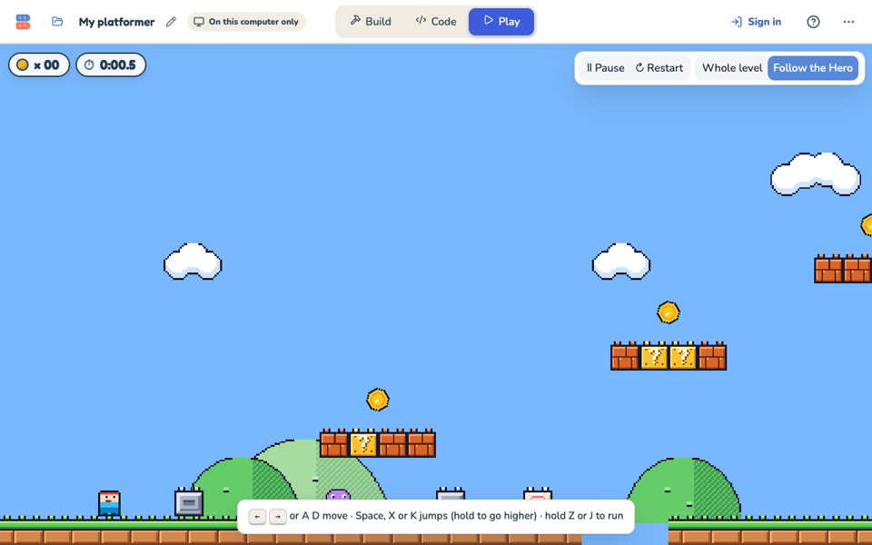
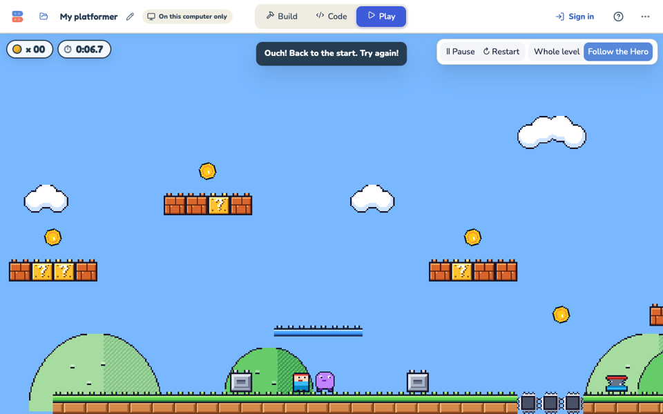
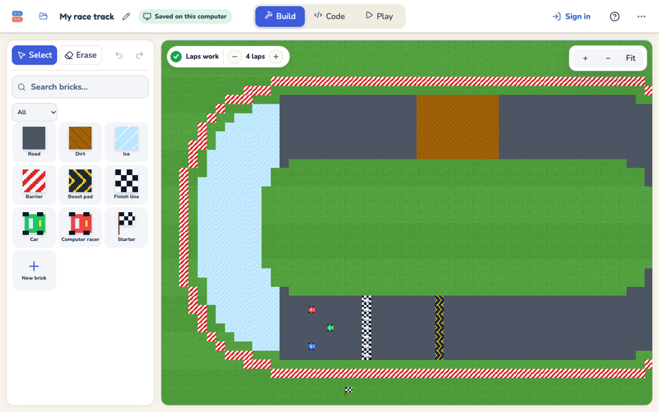
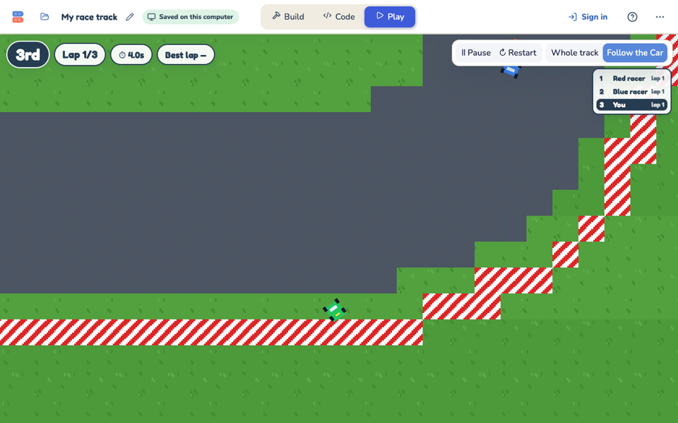
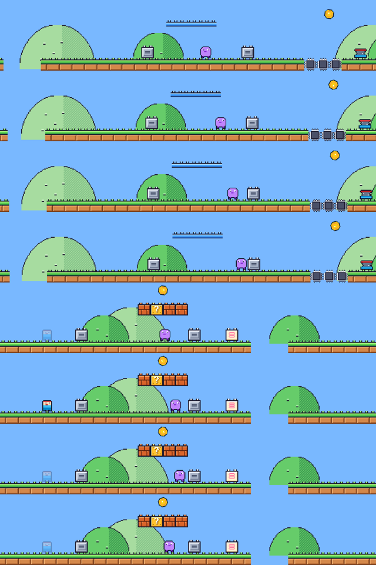

# Parity bucket A: rules and feel, November 3, 2026

Bucket A of the [classic vs Hackable parity audit](README.md): the cheap gaps a student notices in the first minute of
the Hackable Platformer and Hackable Racing.

- **Branch:** `claude/parity-a-d30e0c`, on top of Hackable rooms M0/M1 (`be4dfd79`) and the audit (`47e6d228`).
- **State:** committed locally. Nothing was pushed or deployed.
- **Commits:** one for each item, in the task's order. Hero movement changes have their own commits (A4b and A9).

## Before and after

| # | Item | Before | After | Commit |
|---|---|---|---|---|
| 1 | **Pits** | The level floor was solid everywhere, so the starter's gap was a 16 px dip. | A Platformer level with `pits` has no floor. The Hero's new "Fall into a pit" script hurts it once its box top is a tile below the level (classic: `p.y > (height + 1) * TS`). Racing keeps all its walls. | `13db31b3` |
| 2 | **Keys** | ← → walk, Space jumps, X runs. The Car used the arrows only. | ← → or A D walk; Space, X or K jump (and hold, and on Bounce blocks); Z or J run (classic `input.ts`). The Car also drives with W A S D. The hint, help, touch Run button (now z) and built-in powers were updated to match. | `ac4f67af` |
| 3 | **Getting hurt** | The Hero jumped back to its start in the same tick, with no sound and no safe time. | Same timing as classic: a 0.5 s stop with an "Ouch" sound, then a pop (fade and hide). The Hero is back at its start at 2.5 s and blinks for 2 s, when nothing but a pit can hurt it. The Play screen's "Ouch!" now shows only for a real hurt. | `28a7cc7d`, `eb913873` |
| 4a | **Walker speed** | 3 steps a tick (90 px/s). | 1 step a tick (30 px/s, classic 0.5 px/frame). The slider keeps a 0–6 range. | `b26017e1`, fix `bb008301` |
| 4b | **Spring** | One launch speed of 14, with full gravity. Boing was heard on 2–3 ticks, so the Hero skipped gravity. | Classic springHigh 6.75 px/frame with jump held, springLow 4.5 without. The launch counts as a jump, so holding jump floats the Hero. Only the first boing throws. Rise is about 184 px held (classic 179) and 29 px otherwise (classic 25). | `9f2cb407` |
| 5 | **Camera** | Locked to the player, with no look-ahead. Racing showed 360 steps on the short side, so cars were small. | `FollowRig` is ported from classic. **Platformer:** up to 40 px look-ahead, eased scrolling, the player kept in the middle 35–65% across, settling on the ground and a cut after respawn. **Racing:** looks 16 frames ahead of the car and shows 240 steps on the short side (classic: 224–256). | `b4133c48` |
| 6 | **HUD** | Platformer: coins only. Racing: lap and place; the results had places with no times. | **Platformer:** a timer (game ticks, `0:07.3`), plus Time and Best (or "New best time!") on "You made it!". **Racing:** a race clock from the tick "go" is said, best lap, live standings and each finisher's time on the results. | `4732cdc8` |
| 7 | **Racing build** | Laps were only a Stage variable. The finish arrow was on the card only. Boost pads had no direction (and R1 art pointed left). Racers snapped to the track direction. | **Laps:** − and + in Build (1–9). **Finish line:** arrows on its cells in Build and Play. **Boost pads:** they point a way (`GridSpec.way`, Turn in the inspector), and the Car boosts only within about 70° of it (classic 0.3). **Computer racers:** they steer at the angle × 3 and lift off and brake above 52° at speed (classic `raceAutopilot`). | `cbb9bc25` |
| 8 | **Cars bump** | Cars drove through each other. | Racers closer than their radii (5.5, classic `CAR_RADIUS`) are pushed apart half each, never into a barrier, and trade 0.6 of their closing speed (classic `bumpCars`). | `81dab735` |
| 9 | **Wall slide** | FEEL.md read 90 px/s (steady 105). | 60.0 px/s, the same as classic. "Wall grab slowdown" was converted as a speed (× 2 = 1.5); it is a change per frame (× 4 = 3). | `0370bd5f` |
| 9 | **Ceiling corner nudge** | None. | **Deferred.** See below. | — |

Also: `8b540ba3` fixes the Racing feel writer, which failed on paths with a space ("Virtual Legos").

## What was decided, and why

- **The floor opens per level (`LevelDesign.pits`), not for every Platformer.**
  - A Hero a kid changed doesn't upgrade, so it may not have the pit script. On an open floor it would fall forever,
    with no way back.
  - Pits are switched on by the starter level, and by loading a save whose Hero is today's built-in Hero. That covers
    an untouched old Hero, which upgrades first.
  - Levels whose Hero was edited keep their solid floor. So do test rooms and the engine's own tests (about 40 of them
    assume a floor).
- **The pit check doesn't broadcast "hero hurt".**
  - In a room every Hero hears that message. This is already the case for Walkers, Spikes and Lava; I didn't touch it.
  - Each Hero hurts itself, then says `ouch`.
- **No death hop.**
  - Classic's hop lifted the Hero above a Walker it was touching. The Walker's own stomp check ("Hero above me")
    then counted a stomp and hid itself.
  - The Walker can't ask whether the Hero is hurt, because the editor's "of" menu has fixed properties.
  - So the Hero pops in place and hides until it comes back. The timing is classic's.
- **Shift is not a run key.**
  - The rooms protocol only accepts space, enter, the arrows, a–z and 0–9. It is owned by the rooms lane.
  - Z and J run instead.
  - The built-in Dash power moved from Z to C, because holding Z to run would dash over and over.
- **Bumping is a rule of the Racing kit, like lap counting.**
  - It runs after the scripts and physics, in world order, using only + − × ÷ and a square root.
  - Doing it in each car's own blocks would need N-body sensing that the blocks don't have.
- **The racer's braking threshold is never reached on the beginner track.**
  - The track's direction there turns at most about 45°, so racers only steer.
  - A test forces a sharp turn to prove the brake works.
- **Platformer best times last per level while the page is open.** Classic stores best times only for its built-in
  courses.

## Saved projects (upgrade paths)

Built-in bricks are block code that kids may have edited. Each change keeps old saves opening, and keeps kids' edits.

- **Hero.** The shipped Hero is `88bce6fb`, which is the `hero-before-pits.json` fixture.
  - When untouched, it upgrades on load. Slider values, costumes, the kid's sounds and its names are kept.
  - It also gets the Ouch sound.
  - Its "wall grab slowdown" moves from the old default 1.5 to 3. A value the kid moved stays.
  - A Hero with changed blocks, a renamed variable or a remix is left alone, and its floor stays solid.
  - Old movement labels still fold into "How I move".
- **Car (`f3157bf8`) and Computer racer (`3f8004eb`).** These are R1 as shipped.
  - They go through the new generic `upgradeUntouchedBricks` (`EARLIER_BUILT_IN_FINGERPRINTS`).
  - Edited, renamed or remixed ones stay as they are.
- **Walker.**
  - An untouched Walker still at the old default of 3 moves to 1 (`BUILT_IN_DEFAULT_CHANGES`).
  - A chosen speed, a copy's own speed, or changed blocks stay.
- **Boost pad.**
  - An R1 pad gets the finish line's way.
  - Its R1 picture is replaced only if nobody repainted it.
- Each path has fixtures and tests: `pits.test.ts`, `classicKeys.test.ts`, `walkerSpeed.test.ts`, `hurt.test.ts`,
  `raceBuild.test.tsx` and `plainNames.test.tsx`.

## Deferred

- **Ceiling corner nudge** (classic `rise()`, up to 4 px).
  - It would go into the Hero's "move and collide" plumbing as a loop of tries. That needs the plumbing My Block made
    warp, or a new Platformer block.
  - The plumbing is meant to be readable, so this is the owner's call.
  - The feel harness has no ceiling scenario (FEEL.md: corner nudge not measured), so it couldn't guard the change.
- **Shift to run.** See above. It needs the rooms protocol and `sensing.ts` to accept `shift`.
- **From the audit row, not in this task:**
  - Walkers coming back after a stomp.
  - Checkpoints (bucket B).
  - Undo for the laps −/+ (the Build chip gets no history).

## Verification

Run on the final tree (`0370bd5f`, plus `bb008301`), with Node 22.

- **`npx vitest run src/platformer/lab`:** 1790 passed and 25 expected-fail.
  - The baseline had 1738 passed, plus one failure in the Racing feel writer, now fixed.
  - Long CodeEditor tests sometimes time out when the whole suite runs at once. They pass alone.
- **`npx tsc -p tsconfig.app.json --noEmit`:** the only errors are the 3 that were already there, in
  `src/classroom/StudentInvites.tsx` and `src/pages/worlds/WorldsPage.test.tsx`. Neither file was touched.
- **Feel harness, Hero (`docs/qa/code-lab-core/FEEL.md`):** 25 of 25 inside tolerance after every Hero commit.
  - Wall slide is now 60.0 vs 60.0.
  - Wall jump apex is now 60 vs 62.
- **Feel harness, Racing (`docs/qa/hackable-modes/RACE_FEEL.md`):** unchanged.
- **`node scripts/qa/lockstep/run.mjs --strict-rejoin`:** after every game commit, all 4 timelines (Platformer and
  Racing, solo and room) were the same in Node, Chrome and WebKit, and for the late joiner.
- **Browser** (headless Chrome against the dev server, 1280×800):
  - It caught an import cycle that crashed the studio on load (fixed in `bb008301`; Vitest's import order hid it).
  - **Platformer:** the timer and hint; running and jumping the gap; "Ouch!" from a Walker; the pop, the cut back to
    the start and the blink (the Walker kept walking).
  - **Racing:** the laps chip at 4 laps; the arrows on the finish line and the right-pointing boost pad; Play with the
    clock, best lap, live standings and bigger cars.

| | |
|---|---|
|  |  |
|  |  |

Hurt sequence (top to bottom, 0.4 s apart): the Hero gone, then back at the start blinking:

## Notes for other lanes

- **Rooms.** Room players' Cars spawn 20 steps apart along x (`core/players.ts`), which is straight ahead on the race
  line, so player 1 now rams player 2 at "go". Grid slots side by side would match classic. A note is in the shared
  session notes folder.
- **Help copy.** `src/pages/help` doesn't list Hackable keys, so it needs no change. The studio's own help text and
  hints were updated.
