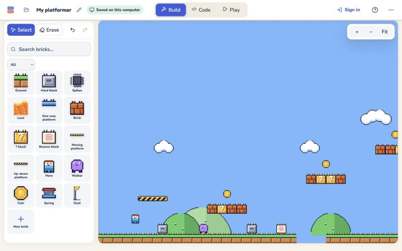
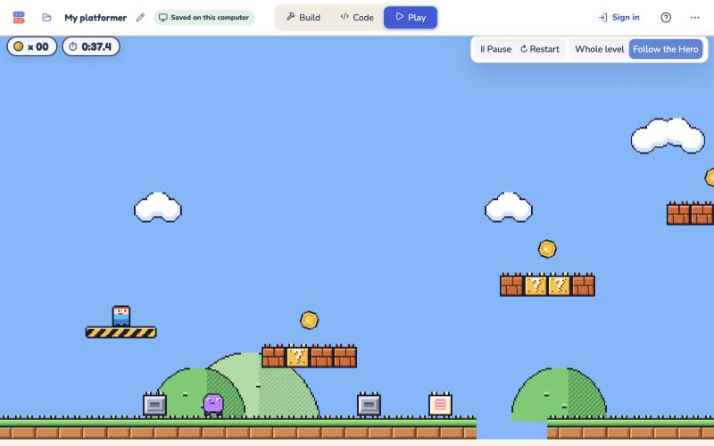
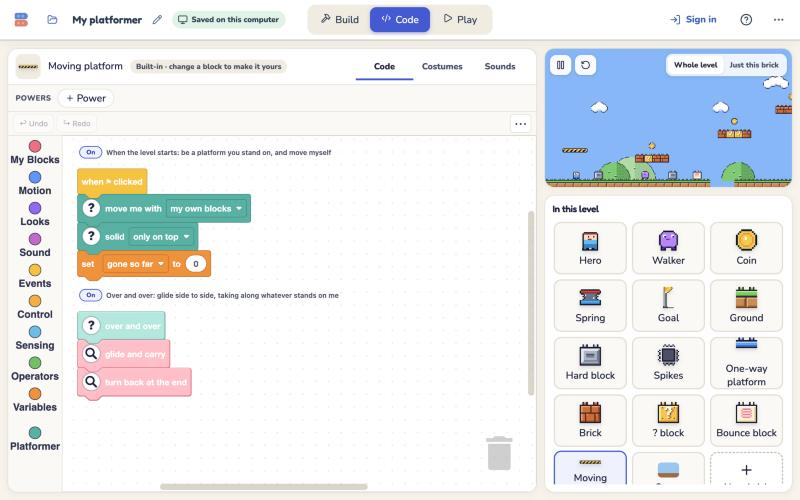
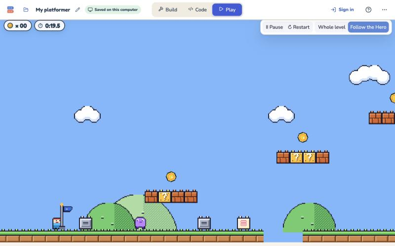
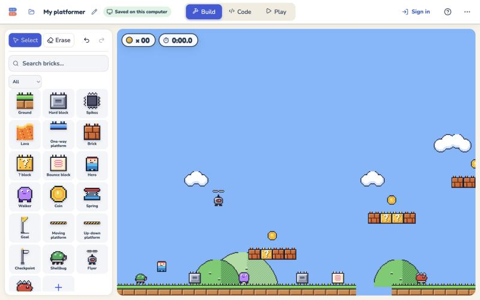
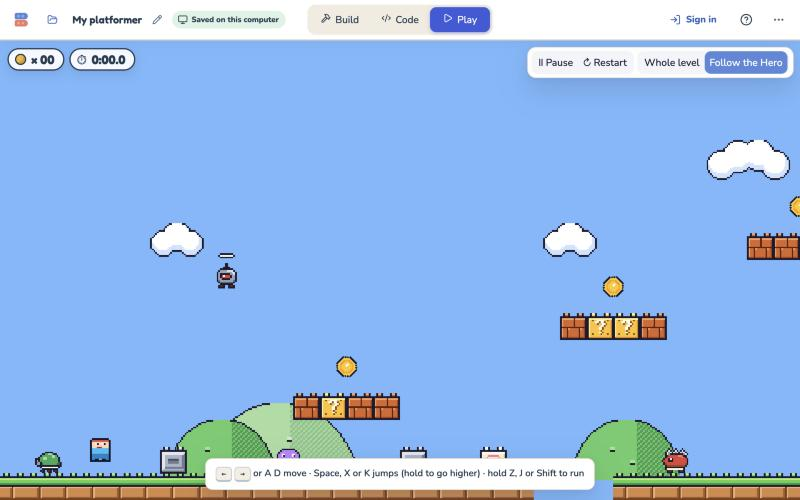
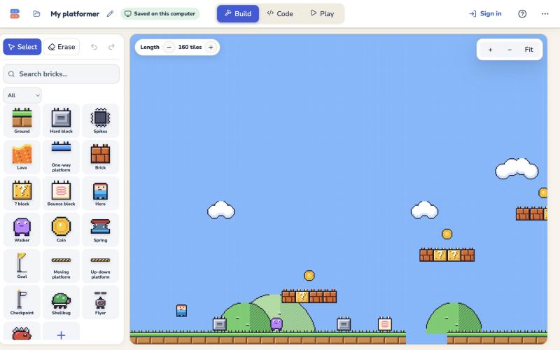
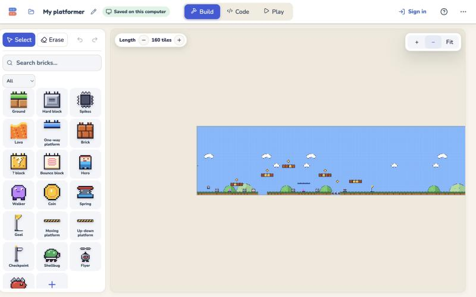
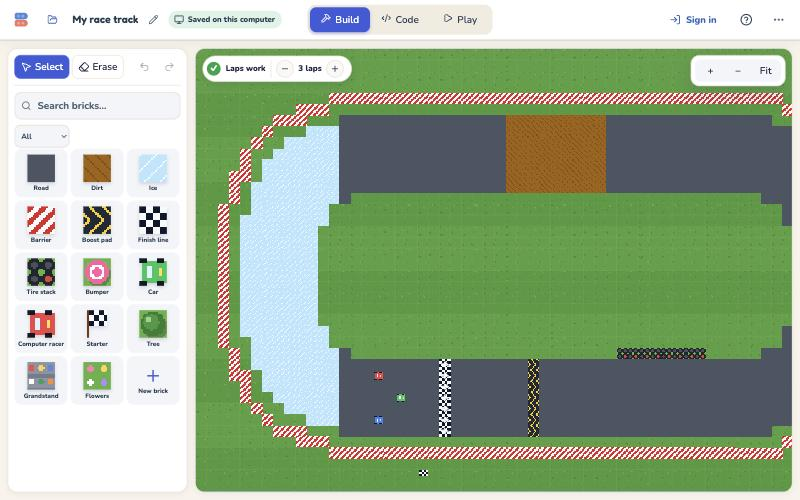
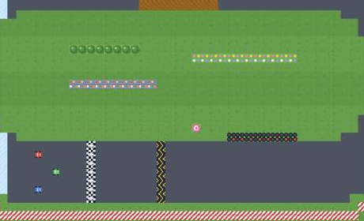

# Parity bucket B: content as bricks, November 4, 2026

Bucket B of the [classic vs Hackable parity audit](README.md): classic's missing bricks rebuilt as Hackable bricks kids
can open. Each one has readable block code, sliders for its numbers, a place in the drawer, and classic's sound where
classic has one. Bucket A ([A.md](A.md)) was rules and feel.

- **Branch:** `claude/parity-b-5d6994`, from production main `32ce3e0b`.
- **State:** committed locally, one brick per commit. Nothing was pushed, opened as a PR, or deployed.
- **Commits:** 14, `7f426859` to `668f5421`, plus this record. The list is below.

## 1. Which classic bricks kids use

The owner approved one read-only count. The full table, method and caveats are in [B-usage.md](B-usage.md).

- **What was counted:** 566 saved classic Platformer projects (356 owners) and 127 Racing projects (94 owners).
- **What came back:** counts only. No ids, names or level content left the database, and nothing was stored.

Missing in Hackable, by projects using it:

| Platformer | Projects | | Racing | Projects |
|---|---:|---|---|---:|
| Longer levels (the default 160 tiles) | 566 | | Items on (a track setting) | 125 |
| Cartoon look | 500 | | Tree | 111 |
| Moving platform (side to side) | 268 | | Grandstand | 108 |
| Checkpoint | 245 | | ? block | 107 |
| Pipe | 238 | | Coin | 106 |
| Shellbug | 215 | | Water | 104 |
| Flyer | 211 | | Walker | 102 |
| Spiky | 201 | | Tire stack | 100 |
| Grow power-up (placed) | 177 | | Flowers | 97 |
| Up-down platform | 154 | | Jump ramp | 95 |
| Spark power-up (placed) | 150 | | Bumper | 92 |
| Underground theme | 126 | | | |

**Nothing can be dropped.** Every missing Platformer brick is in at least 27% of projects, and every missing Racing
brick in at least 72%.

## 2. The order, and why

**Platformer first, by usage, with two adjustments:**

- **The ceiling corner nudge came first.** The owner decided it on 2026-11-04 (a new Platformer block, used by the
  Hero), and it was small.
- **Pipes (238) moved after the critters (about 200 each).**
  - Pipes are one large item: a two-wide brick, pipe-to-pipe links in the editor, and the Hero travelling through them.
  - The three critters are three Walker-sized bricks for nearly the same number of projects.
- **Longer levels came next (566 projects).**
  - It is cheap, and every saved classic level uses the 160-tile default.
- **Stopped there for the Platformer.** What's left is large and mostly needs the Hero or the M2 lane's bricks first:
  pipes, Grow/Spark, the looks, poses, and courses (section 5).

**Then Racing.**

- One change to the Car first: a general "what I hit" block, and a bounce for each kind of wall.
- Then the five cheapest classic track bricks: Tire stack, Bumper, Tree, Grandstand and Flowers.
  - These are 92–111 tracks each, and their usage is nearly flat.
  - Items, coins, water, ramps and Walkers each need new Car behaviour; they are left with estimates.

## 3. Done

### New general blocks

Each is kept general so kids can reuse it. Each has a plain-Scratch card ("how it works in plain Scratch") and its own
tests.

| Block | What it does | Used by |
|---|---|---|
| `slip past a corner up to (4) steps` | After a "move until I hit something" stopped by a brick that overlaps by n steps or less, step aside and finish the move. Moving sideways, the same block steps up a low ledge. | Hero |
| `move [x] by (2) and carry what stands on me` | Moves through anything, like "change x by", and takes along every body standing on top. Each rider is swept, so walls stop it. | Moving platforms |
| `what I hit` | The name of the brick the last move stopped at, "edge" for a wall or the floor, or nothing. | Car, Computer racer |

### Platformer

| Brick | Before | After | Classic numbers compared | Commit |
|---|---|---|---|---|
| **Ceiling corner nudge** | Jumping into a block's corner stopped the Hero dead. | "move and collide" slips past a corner while going up. The new **corner slip** slider (4) sits under More sliders > Jumping. | The head 1–8 px under a corner: classic and Hackable both slide by the overlap for 1–4 and stop for 5+, step for pixel (`cornerSlip.test.ts`). | `ae8e2267` |
| **Moving platform**, **Up-down platform** | None. | Classic lift art. Solid only on top. Moves itself at **speed** 2 a tick over **distance** 80 (sliders), carrying riders. Sideways starts left, up-down starts up, as placed classic lifts did. | The span is 80, with a turn every 80 frames (40 ticks). While riding, the classic and Hackable Heroes keep the same distance to the lift every frame and tick. A Walker rides too. | `98a9eafd` |
| **Checkpoint** | None. Getting hurt always sent the Hero back to its start. | Classic flag: up on touch, with the classic jingle, and it says `checkpoint`. The Hero's new receiver makes the spot where it stands its start. Only the newest flag is up. | Same course (start, flag, pit): both Heroes come back at the start with no flag, and by the flag after one. | `15b85af7` |
| **Spiky** | None. | Walks at classic speed and hurts from every side. **speed** slider. | 30 steps a second, as classic. | `6b22db00` |
| **Flyer** | None. | Bobs around home with a constant pull. Stomped, it loses its wings and walks; stomped again, it's gone. **speed** and **fly speed** sliders. | Its whole bob track equals classic's, tick for frame: 25 either side, 160 frames a bob. | `6b22db00` |
| **Shellbug** | None. | Walks. Stomped, it hides in its shell. Touched, the shell slides away from the Hero and hurts what it runs into. A stomp stops it, and a resting shell wakes up. **speed** and **shell speed** sliders. Classic stomp and kick sounds. | Slide 6 a tick (3 px a frame); wakes after 255 ticks (510 frames). | `6b22db00` |
| **Longer levels** | 60 tiles, with no way to change it. | A **Length − / +** chip in Build. 20 tiles a step, up to 400. The floor carries on. − never cuts a painted cell or a placed brick. | Classic levels are 160 × 27. 160 is now three clicks away. | `a17aa227` |

**Also in these commits:**

- **The drawer offers built-in bricks before a level has them** (`studio/builtins/extras.ts`).
  - Picking one adds it under its catalog id, so "Back to the original" and "My …" work.
  - New projects don't carry these bricks, so saves stay small.
  - The starter's own bricks keep their places in the drawer; the new ones come after them.
- **Classic sound effects as Hackable sounds** (`studio/assets/classicSounds.ts`). The classic synth notes are rendered
  once into WAV, with seeded noise, so the result is the same every time.
- **Engine fix** (`4d77624d`). An up or down move that crossed two faces in one tick kept the farther one, so a fast
  brick could end up inside the nearer solid. Found while testing the corner slip.

### Racing

| Brick | Before | After | Classic numbers compared | Commit |
|---|---|---|---|---|
| **Car: bounce by what it hit** | Everything solid bounced 0.35. | The new My Block "how bouncy is what I hit" covers barriers, tire stacks, bumpers, trees and grandstands. New sliders are under More sliders > Bumping into things. Flowers count as grass. | Drive flat out into each kind; the bounce matches classic `car.ts` (`whatIHit.test.ts`). | `157a6579` |
| **Tire stack** | None. | A solid grid brick in classic art, under Track. | 0.08 of the speed back. | `024dbb03` |
| **Bumper** | None. | A solid grid brick, under Track. | All the speed back, plus a 4.8 kick (2.4 px a frame). | `7afc1f0e` |
| **Tree** | None. | A solid grid brick, in a new **Scenery** tab. | 0.25 back. | `38c41c96` |
| **Grandstand** | None. | A solid grid brick, under Scenery. | 0.25 back. | `0519584c` |
| **Flowers** | None. | Ground with no code, under Scenery. | Cars drive over it at the grass speed (0.45 of road). | `842ec1d6` |

Racing's drawer offers these before a track has them. A paint character already in use is swapped for a free one.

### Saves stay compatible

- **The Hero.** The production Hero (`c4c19cce`) upgrades when untouched and keeps its slider values. Its fixture is
  `hero-before-corner-nudge.json`.
- **The Car and Computer racer.** The production Car (`cd3793ca`) and racer (`68d4e698`) upgrade the same way, with
  fixtures `*-before-what-i-hit.json`.
- **Edited, renamed or remixed bricks** stay as they are.
- **New blocks use "later" ids**, so every older block keeps its id.
- **Saving and opening.** A project with each new brick saves to a file, opens again and plays the same. In the browser,
  every new brick survived a save and reload.

### Screenshots

| | |
|---|---|
|  |  |
|  |  |
|  |  |
|  |  |
|  |  |

Also in `b/`: `checkpoint-build.png`, `shellbug-shell.png`, `race-tires-drawer.jpg` and `race-tires-painted.png`.

## 4. Checks

Results for the final tree are under "Final run" below.

- **tsc** (`npx tsc -p tsconfig.app.json --noEmit`): clean after every commit.
- **vitest:** the lab suite was green at each commit except the known flake `perf.test.ts`, which passes alone. The
  full app suite was run on the final tree (below).
- **Feel harness:** 25/25 after both Hero commits; FEEL.md is unchanged. The Racing feel harness is unchanged after
  the Car commit.
- **Lockstep** (`node scripts/qa/lockstep/run.mjs --strict-rejoin`):
  - after the engine fix and the platforms: all 4 timelines were the same in Node, Chrome and WebKit, and for the late
    joiner;
  - on the final tree: below.
- **Browser** (the studio on the Vite dev server, 1280 × 800). Each brick was picked from the drawer, placed or painted,
  played, and reopened after a reload.
  - **It caught two bugs, both fixed before their commits:**
    - the Shellbug fell through the floor when it woke up (costumes now stand on one line);
    - the drawer pushed the Hero and Walker down the list.
  - **Input:** keys were sent as real keyboard events. A few positions were set from the console to save time: dropping
    the Hero on a lift or a Shellbug, and sending one "hero hurt".
  - **The dev server's hot reload is not a product bug.** Twice it replaced an open project with an older copy while I
    edited files. A plain reload kept everything.

### Final run

- **tsc:** clean (exit 0) on the final tree.
- **Full app vitest suite** (`npx vitest run`, on `842ec1d6`): 3729 passed, 25 expected-fail, and 4 failed, in 3 of
  346 files.
  - **Two were real misses** of the Car commit (`157a6579`), which had only run the race, editor and feel tests. Its
    top view now shows a second My Block, and its card has 19 "More sliders". Fixed in `668f5421`.
  - **The other two are the known `CodeEditor.sections` timeout.** They pass alone.
  - **All 3 files re-run alone on `668f5421`:** 24 of 24 passed.
  - A second full run on `668f5421` is recorded in the commit after this one.
- **Feel harness:** 25/25, and FEEL.md is unchanged. Racing feel is unchanged.
- **Lockstep `--strict-rejoin`** (on `842ec1d6`): platformer solo, platformer room, race solo and race room were all
  the same on all 1800 ticks in Node (twice), Chrome 156 and WebKit 26.5. The late joiner at tick 900 was the same to
  the end in all four (exit 0).

## 5. What's left, with estimates

Estimates are for one person, including tests and a browser check.

### Platformer

| Item | Projects | Estimate | Notes |
|---|---:|---|---|
| **Pipes**, with links | 238 (65 linked) | L, 3–4 days | Needs a two-wide brick (a pair GridSpec, or a pipe copy with a height), links in the inspector, a "go down the pipe" Hero receiver (hold down on a mouth), and the travel. |
| **Grow and Spark**, ? and Brick contents, big Hero, crouch, throwing, breaking bricks | 177 + 150 placed, 82 + 50 in blocks | L, 4–5 days | Changes what happens when the Hero is hurt (shrink instead). That is the M2 lane's area, so do it after M2 merges. The ? block already has a "times left" slider; contents would be a menu. |
| **The cartoon look** | 500 | L, 3–5 days | A second set of costumes for the grid bricks and critters, and a level setting to switch them. |
| **Underground theme** | 126 | M, 1–2 days | A dark backdrop and the underground ground costumes. |
| **Sound effects on the starter bricks** (coin, spring, bump, stomp, goal, jump) and **music** | — | M, 1–2 days | The renderer is ready. Walker and Goal belong to M2; the Hero's jump sound is a Hero change. |
| **Critters, finishing touches:** shells knock out critters and bump ? blocks; critters turn when they meet | — | M, 1–2 days | Needs a way to tell a sliding shell from a walking one by touch, for example a separate Shell brick created as a clone. |
| **Walk and run poses, characters** | — | L | Costumes plus Hero looks scripts. |
| **Level height** (classic 27 rows, Hackable 22) | — | S | The length chip's other half. |
| **The 3 classic courses** | — | M, 1–2 days | After pipes and power-ups. |
| **Checkpoint position** | — | S | It comes back where the Hero stood (up to a tile before the flag); classic centres it on the flag. Exact centring needs the flag's own position (for example, globals the flag sets). |

### Racing

| Item | Tracks | Estimate | Notes |
|---|---:|---|---|
| **? blocks and items** (Turbo, Oil, Ball, Spark, Shield), "Items on" | 107 (125 with items on) | L, 4–5 days | Item bricks as clones, plus Car receivers. |
| **Water** | 104 | M, 1 day | The Car needs splash, a pause and a respawn at its last safe spot. |
| **Jump ramps** | 95 | M, 1–2 days | Air time in the Car: grip off, weak steering, and water under it doesn't count. |
| **Coins** | 106 | M, 1 day | Classic coins raise the top speed. |
| **Walkers on the track** | 102 | M, 1 day | They walk across or along the road and spin cars out. |
| **The studded track look** | — | M | A costume set. |
| **The 4 classic tracks** | — | M | After items, ramps and water. |

**About 3 weeks of bucket B remain:** about 2 for the Platformer and 1 for Racing. Pipes, power-ups and items are the
three big ones.

## 6. Notes for other lanes

There is a hand-over note at `side-session-notes/…/parity-b.md`.

- **M2 (Hero hurt and finish; rooms).**
  - **The Hero changed in two places:**
    - its "move and collide" (the slip);
    - one new receiver (`checkpoint`).
  - Its hurt and finish scripts are untouched.
  - Merging the two lanes will conflict in `heroBrick.ts` and `remix.ts`. Keep both sets of changes, and keep
    `c4c19cce` in `EARLIER_HERO_FINGERPRINTS`.
  - **The new bricks rely on M2's per-player broadcasts:** "touching the Hero, then broadcast".
- **Everyone.**
  - The Platformer palette has three new blocks, so the pin in `toolbox.test.ts` changed.
  - There is one engine change (`sweepY` keeps the nearer face).
