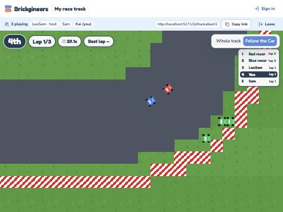
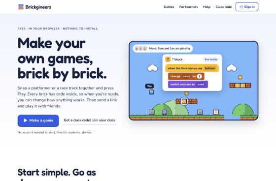
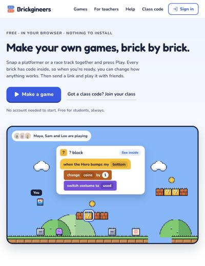
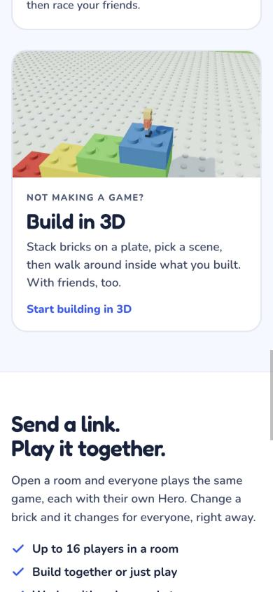
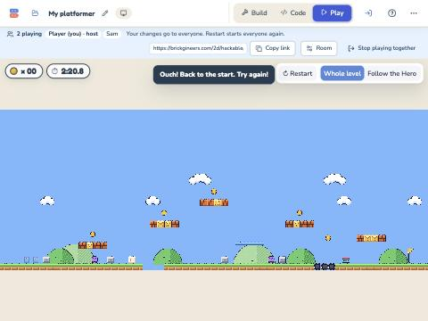
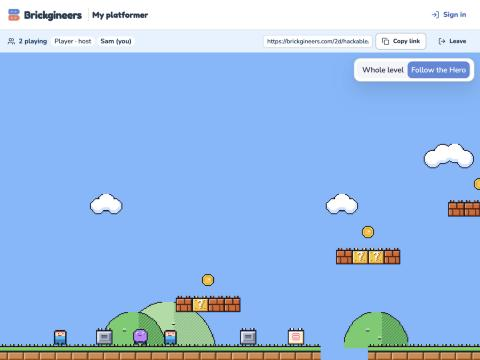

# Hackable rooms, Parity A and Landing v2: November 4, 2026

**Live on brickgineers.com:** Worker `c0b06a58`, site `dpl_AC6ubz7CKB3ZREfBBL1kGPKGNhpE`.

Branch `claude/hackable-int-c541e7`. On top of production (main `0a7efbd`, Hackable Racing R1) it adds:

- **Hackable rooms** (`claude/ship-rooms-868d57`): Play together for Hackable projects, from My projects, the class
  page and the invite sheet, with host controls (close, remove, let back in) and reconnect.
- **Parity bucket A** (`claude/parity-a-d30e0c`): pits, the hurt-and-respawn sequence, bumping, the HUD timer, the race
  clock and live standings.
- **Two loose ends from the integration:** room Cars on a starting grid, and Shift to run (rooms included).
- **Two room-screen fixes**, after the owner's "Yes, fix then ship":
  - screens keep hearing the game after Play again;
  - each screen shows its own player's feedback and Car.
- **Landing v2** (`claude/landing-v2-bb8fd2`): the new landing page and the "Make a game" picker.

The integration record, with the grid and Shift fixes and the first browser check, is `docs/qa/hackable-int/README.md`.

## Commits

| Commit | What |
|---|---|
| `94f0b317` | Merge Parity A (`58c232a5`) |
| `d66cdb89` | Merge main `0a7efbd` (no file changes) |
| `f0d11fae` | Room Cars line up on a starting grid, like classic Racing |
| `19b390db` | Shift runs, in rooms too |
| `2d311e9a` | Integration record |
| `5c1aa8b5` | Fix: screens keep hearing the game after Play again |
| `46f468c9` | Fix: each screen shows its own player's feedback and Car |
| `524a8bc6` | Merge Landing v2 (`232f36a4`, a clean merge) |

## The two room-screen fixes

**1. Screens keep hearing the game after Play again (`5c1aa8b5`).**

- **The bug:** a room's screens hold one facade for the whole session, but `onBroadcast` was bound to the game of the
  moment. After the host's Restart (or a project restart), the race clock, "Ouch!" and "You made it!" were listening
  to a game nobody played. That is why the race clock read a stale 94.7 s.
- **The fix:**
  - `HackableTimeline` watches whichever game is running, including each new one a Play again builds. It passes each
    broadcast on once, as it is first played; ticks played again after a rewind stay quiet, like their sounds.
  - `RoomSession.onBroadcast` lasts across resyncs, and the facade uses it.
  - `RoomSession.playStart` is the tick the play on screen started: a fresh game's first tick, or the last Play again.
    It is the same in every player's game.
  - `PlayFeedback` and `RaceHud` remember things per play. A new play clears the finish card and the toast, and the
    race clock waits for the new "go".
  - A room's Platformer timer counts from the play's start. Before, it counted the room's clock, which carries on
    across plays.
- **Outside a room** nothing changes.

**2. Each screen shows its own player's feedback and Car (`46f468c9`).**

- **"Ouch!" and "You made it!":** `aboutMyHero` decides whose a broadcast is.
  - A Hero's own words ("ouch") belong to its player.
  - Anything else (the Goal's "course clear", a hazard's "hero hurt") belongs to the Heroes touching whoever said it.
  - When no Hero touches the sayer, it is everyone's.
  - Broadcasts now carry the sprite that said them (`Runtime.onBroadcast(message, from)`).
- **The race HUD:** it follows our own player's Car. Only that Car is "You"; other players' Cars go by their room
  names. Finishers are listed in the order they crossed the line, because every room Car's costume is "You", which
  made the results list's names ambiguous.

Both fixes are display only. They read the world and never change it. Lockstep, fingerprints and the feel harness are
unchanged (below).

## Checks before the deploy

| Check | Result |
|---|---|
| New tests | 4 for fix 1: timeline, room session, PlayFeedback and RaceHud in a room. 4 for fix 2: aboutMyHero, PlayFeedback in a room, and two race-HUD-in-a-room tests. Each fails on the code before its fix. |
| `npx tsc -b --noEmit` (after the landing merge) | Clean |
| App `npx vitest run`, full suite (after the landing merge) | 336 files: 3,655 passed, 25 expected to fail, 0 failed (no flakes this run) |
| Worker `npm run test:worker` | 14 files, 263 passed (run in the release worktree, which has its own node_modules) |
| Hero feel harness (`npx vitest run src/platformer/lab/feel`) | 64 passed, 25 expected to fail. `FEEL.md` regenerated byte-identical: **25 of 25** inside tolerance. |
| `node scripts/qa/lockstep/run.mjs --strict-rejoin` | All 4 timelines (Platformer and Racing, solo and room) are the same on all 1800 ticks in Node v26.8.2 (twice), Chrome 156 and WebKit 26.5. The late joiner at tick 900 matches to the end. `docs/qa/hackable-rooms/lockstep/summary.json` is regenerated from this run. |

### Browser check, local Worker (`wrangler dev --local`) and Vite

**Platformer, two tabs** (host in the studio, a guest on the join page):

- **After Restart:** both tabs gave the same `playStart` (2219), and both timers restarted from 0:00.
- **Walker:** the Walker's "hero hurt" hurts every Hero in a room (a known game behaviour; see below). Both Heroes
  said "ouch" on tick 5824, and each screen showed its own "Ouch!".
- **Pit:** only the guest's Hero fell (x 361, y −30) and said "ouch" on tick 6256. The guest's screen showed "Ouch!";
  the host's did not, although it heard the broadcast (DOM observer: host toast ticks `[5825]`, guest `[5825, 6257]`).
- **Fingerprints:** identical at tick 6356. 0 resyncs and 0 rewinds; no console errors.

**Racing, three tabs** (the host and two guests, Sam and Kai):

- **Restart:** `playStart` 1735 in every tab. The countdown ran 3, 2, 1, Go!, and "go" came on tick 1825 in every tab.
  The race clock started from 0.4 s, with no stale time.
- **Grid:** the Cars stood at (296, 136), (286.4, 113.6) and (270.4, 136).
- **Standings, all three holding W:** each screen marked only its own Car "You" and named the others.
  - Host: 3rd, with Kai and Sam named.
  - Sam: 5th, with LeeSam and Kai named.
  - Kai: 4th, with LeeSam and Sam named.

  "LeeSam" is the in-app browser's saved guest name, a test artifact.
- **Reconnect:** I closed Sam's socket, and he came back as player 2 (a fourth `connect` in the Worker log). He had the
  same Car, still "You", and 0 resyncs.
- **Remove:** the host removed Kai. Kai's tab said "The host removed you from this room", and the others' standings
  dropped him.
- **Fingerprints:** identical at tick 3944. 0 resyncs; no console errors.

**Landing v2:**

- At 1366, 768 and 390 wide: no horizontal scroll. All images load; the four lazy ones load in view, and the files
  return 200. No console errors.
- **The "Make a game" picker:** it lists Platformer and Racing, each with "Start" and "Start with code inside".
  - Platformer "Start" opens the classic builder `/2d/build?new=1`.
  - "Start with code inside" opens Hackable `/2d/hackable?new=1`.

| 1366 | 768 | 390 |
|---|---|---|
|  |  |  |

## Deploy

The owner approved shipping ("Yes, fix then ship"). [PR #28](https://github.com/ahmaadidrees/brick-studio/pull/28).

**Worker, first:** `c0b06a58-f37b-4ffb-9b5d-cf8712b744f9`.
- It adds the `HackableRoom` Durable Object (migration v5) and the Shift key allowlist.
- Rollback: `3842d41c-aeca-4f29-b05b-3c3ebcd54952` (Hackable Racing R1).
- `npm run test:worker`: 263 of 263.
- Deployed with `npx wrangler deploy` (the production default env) from the release worktree.
- After the deploy, `GET /hackable/rooms/<made-up id>` answers 404 `room_not_found` from the new handler.

**Website:** `dpl_AC6ubz7CKB3ZREfBBL1kGPKGNhpE` on https://brickgineers.com, serving `index-e16y6EJp.js`.
- Rollback: `dpl_Fi22yqRw489wJzBZi6jpgXAg36Bo` (Hackable Racing R1).
- To roll back, run `vercel promote dpl_Fi22yqRw489wJzBZi6jpgXAg36Bo`, then
  `npx wrangler rollback 3842d41c-aeca-4f29-b05b-3c3ebcd54952` in `multiplayer/worker`.
- **How it was built**, in a new release worktree `~/.codex/worktrees/hackable-rooms-release` (detached at
  `e397c5c7`, with its own `npm ci`, so no symlinked node_modules):
  1. Copied `.vercel/project.json`, `.vercel/output/config.json` and `.vercel/output/static/micro/` from
     `brick-hackable-modes`.
  2. Ran `vercel pull --yes --environment=production`, loaded `.vercel/.env.production.local`, and ran `npm run build`.
  3. Copied `dist/` into `.vercel/output/static`, keeping `micro/`.
  4. Ran `vercel deploy --prebuilt --prod --yes` once. It printed only the JSON hint; `vercel inspect brickgineers.com`
     confirmed the deployment, with aliases brickgineers.com, www.brickgineers.com and virtual-legos.vercel.app.
- The bundle carries the production Worker address. `localhost:8787` appears only as the code's fallback, as in the
  previous release.

**No migration.**

### Checks after the deploy, on production

- **Bundle:** brickgineers.com and virtual-legos.vercel.app both serve `index-e16y6EJp.js`.
- **Routes:** `/`, `/help`, `/join`, `/projects`, `/class`, `/2d/hackable`, `/2d/hackable-race`, `/2d/build`, `/micro/`
  and `/2d/hackable/r/<id>` all return 200.
- **Landing:** the new landing loads ("Make your own games, brick by brick.", with Make a game).
- **`/2d/hackable?new=1`:** opens "My platformer · Hackable Platformer".
- **Play together, guest room, two tabs:**
  - The host opened a room from This project → Play together, and a guest joined by its link as "Sam". Both showed
    "2 playing".
  - The guest's timer counted from the play's start, and the hint says "hold Z, J or Shift to run".
  - The guest's keys reached the shared game. The guest ran into the Walker, and the host's screen showed "Ouch!":
    a Walker hurts every Hero in a room.
  - Shift: I sent Shift with the arrows three times with the tabs steady, and the connection never dropped. One
    "Reconnecting…" (back within a second or two) and a brief "1 playing" came while switching which tab was in front,
    like the background-tab drops seen in the integration check.
  - No console errors. The host then stopped playing together.

| Host (production) | Guest (production) |
|---|---|
|  |  |

## Not checked

- **"You made it!" in a room, in a browser.** Reaching the far Goal through the Walkers and the pit by scripted keys
  isn't practical, so this is covered by unit tests (PlayFeedback in a room).
- **A room race to the results card in a browser.** Holding W doesn't drive a lap. Covered by the race-HUD-in-a-room
  tests.
- Class rooms (signed in, shared with classmates) against the live Worker. Only guest rooms were checked.
- Real devices (Duo, iPad, Chromebook) and Safari.

## Known, not changed here (game behaviour, for the rooms lane)

- **A Walker's "hero hurt" hurts every Hero in a room.** It is a broadcast every Hero hears. Each screen now shows
  "Ouch!" only when its own Hero says it, so this shows as everyone getting hurt, which is what the game does.
- **When one Hero reaches the Goal, the Goal's "stop all" stops the game for everyone.** Only that player's screen
  shows "You made it!"; the others see the game stop until the host restarts.
- The Remove confirm says "Hero" in Racing, and the editor's key menu lists `shift`, which Scratch doesn't have.
- A Platformer late joiner's spot can overlap an existing Hero.
