# Wave 2 integration, batch 1: November 4, 2026

One tested branch with the four wave 2 lanes merged on production main (`32ce3e0b`, PR #28):

1. rooms M2 ("hack together");
2. Parity B (classic bricks as Hackable bricks);
3. Blank 2D ("Start from nothing");
4. Hackable 3D D1.

It also carries the fixes that only showed up once the lanes were together.

- **Branch:** `claude/wave2-int-d16a14`, committed locally. Nothing pushed, no PR, nothing deployed to production.
- **Staging:** the Worker was deployed to staging only (version `49a6eed8-2828-4b42-b6b4-98417967b105`) after the Worker
  tests passed. Three-kid guest rooms were run against it in real browsers.
- **Class rooms with real sign-ins were not run.** The owner then supplied a test teacher login
  (`.env.classroom-qa.local`, git-ignored) and approved one throwaway class. Its teacher login is refused (401
  `invalid_credentials`) by both the staging and the production Worker, so nothing was created; see
  [Staging class room](#6-staging-class-room-blocked-on-test-credentials).

## 1. The merges

Each lane is one merge commit, in the order given, with tsc and the lab tests run after each.

| Order | Merge | Lane tip | Conflicts | tsc | Lab tests after it |
|---|---|---|---|---|---|
| 1 | `9ec97451` | M2 `b672a0d5` | None | Clean | 159 files, 1,831 passed, 25 expected fail |
| 2 | `a5a47890` | Parity B `932a5cd8` | None | Clean | 169 files, 1,909 passed |
| 3 | `b1d014e4` | Blank 2D `62671ff9` | 3 files | Clean | 175 files, 1,942 passed |
| 4 | `513e7255` | Hackable 3D D1 `c442c895` | 16 files | 26 errors, all from the 3D lane's own tree; fixed in `fce5b428` | 188 files (lab + projects + boundaries), 2,114 passed |

### How the conflicts were resolved

**Blank 2D onto M2 + Parity B.** All three were unions:

- `core/editor/knownBlocks.ts`: Blank's `game_touchingplayer`, next to Parity B's `platformer_movecarry`,
  `platformer_slipcorner` and `platformer_whathit`.
- `studio/screen/kitParts.tsx`: Parity B's `LengthChip` (the Platformer's Build chip) and Blank's `BlankHud`. Blank
  keeps no Build chip; its Stage card does the job.
- `studio/store.ts`: `playerIdOf` and `screensFor` from kitScreens, plus Parity B's `freshExtra` and `withLength`.
- The Game category (`toolbox.ts gameCategory`) is built from the Platformer category, so Parity B's new blocks show up
  in a game from nothing with no extra change.

**Hackable 3D onto the rest.** Every registry now holds `platformer`, `race`, `blank` and `3d`.

| File | Resolution |
|---|---|
| `core/index.ts` | `blankEngine` and `engine3d` both kept; `KIT_ENGINES` has all four. |
| `kits.ts` | `'3d'` is ready (D1), and `blank` is "Own game". |
| `core/editor/colors.ts` | Both `CATEGORY_COLORS.game` and `.threeD`. |
| `core/editor/toolbox.ts` | `GAME_PALETTE` and `THREE_D_PALETTE`, and `paletteForKit` picks either. The 3D category replaces Platformer, then the Game category (blank) or Racing goes in. `BODY_CATEGORIES` gains `'Game'`, so the Stage still has none of them. |
| `studio/kitScreens.ts` | `ScreensKit` and `StageBackground` gain both. The 3D entry sets `playNeedsPlayer: true` and `fromNothing: false`. `screensFor` reads the table, and Blank's `backgroundOf` is kept. |
| `screen/kitParts.tsx` | `BlankHud` and the 3D slots. The `Drawer` slot's props take Blank's optional `onBrickMade`. |
| `screen/StudioShell.tsx` | The slot `Drawer` gets `onBrickMade`. `KitStage` and the 3D test room are kept, plus Blank's `EmptyStage` and `BuildScore`. |
| `rooms/RoomPage.tsx` | M2's `RoomBuilder` join, plus 3D's `roomRefusal`, which is checked first. 3D's `followRoomDesign` call is dropped, because M2's builder adopts the room's project. The refusal notice moved below M2's rights hook, so no hook runs after an early return. |
| `rooms/studioRoom.ts` | M2's slim `StudioRoomLink`, plus `roomRefusal` and `ROOMS_3D_SOON`. 3D's `LIVE_EDIT_DELAY_MS` went with M1's live edits, which M2 removed. |
| `StudioApp.tsx`, `routes2d.ts`, `PlatformerApp.tsx` | Each kit's address, `kit` union, `fixAddress` paths and loading line. `/3d/hackable` still never opens a room. |
| `ProjectMenu.tsx`, `hackableProjects.ts` | Start over, new project names ("My game", "My 3D world") and `hackableRoute` for all four. |
| `projectFile.ts`, `ProjectSections.tsx` | `HackableKind` has `'hackable-blank'` and `'hackable-3d'`, with their labels and icons. |

**The 3D lane's 26 type errors** (`fce5b428`):

- **What happened:** its record says "tsc clean" for `npx tsc --noEmit -p .`. The root `tsconfig.json` only has
  references, so that command checks nothing. `tsconfig.app.json`, which `npm run build` (`tsc -b`) uses, had 26 errors
  on the lane's own tip.
- **The cause:** `World3` and `LevelDesign3` intersected array fields (`Target[] & Target3[]`). TypeScript 7 resolves
  `.find` and `.map` on the first member, so a target's `z` and `body3`, and a copy's `z`, vanished.
- **The fix:** they are now `Omit<…> & {…}`, so the 3D element types win and are still assignable to `World` and
  `LevelDesign`.
- **Also:** the 2D Stage draws the sky if it is ever handed a 3D design, and the design-check test casts to
  `LevelDesign3`. There is no runtime change.

## 2. Fixes that only showed up together

Each fix is one commit with its tests. Items (a) to (f) were asked for. Four more were found by the new checks.

| | Commit | What was wrong | Fix | Tests |
|---|---|---|---|---|
| **a** | `007d4957` | A borrowed Coin, Walker, Spikes, Goal and every Parity B critter named the player "Hero", so they ignored a player called Zip. | The sprite menus gain **"the player"** (`PLAYER_MENU`, `'_player_'`), which is the game's player brick by id (`design.player`). Every menu that names a brick resolves it: touching, distance to, "of", go to, point towards (`runtime.findOriginal`), and the bump hat's brick. "touching the player?" now shares "touching [brick]?"'s code, so it is room-aware. The editor offers "the player" in a game from nothing only. Borrow rewrites a borrowed brick's "Hero" menus to "the player" (the Hero and Car keep theirs). Borrow also offers Parity B's 11 bricks. | `borrowPlayer.test.ts`: each borrowed brick reacts to Zip; the kit's own code would not. `playerMenu.test.ts`. **Kit games unchanged:** four kit timelines (Platformer and Racing, each with and without every Parity B brick) give the same fingerprints at every 60th tick as before the change (golden values). |
| **b** | `f309a925` | Blank in rooms: a Hurts job sent every friend back, and a Goal job ended the game for everyone. Blank's `design.player` and `design.backdrop` were outside M2's edit operations, so a classmate's Player job, a borrowed Hero becoming the player, or a backdrop change counted as "something else changed" and was silently put back. | Per-player rules follow from (a): "touching the player?" sets `about`. `BlankHud` follows PlayFeedback's room rules: your own Ouch and You win, "Ben finished, 0:12" for others, host-only Play again, and Watch the others. A new edit operation, `game` (player, backdrop), is checked, applied, undone and summarised like the others. **Choosing the player is code; the backdrop is building** (decision below). Kit designs never carry either. | `blankRoomRules.test.tsx` (rules and screens; fails without the change). `togetherWave2.test.ts`: a blank room through the real room core and three lagged sessions (build, backdrop, a job refused then allowed, the player chosen and undone; every game agrees, no resyncs). |
| **c** | `bed19fad` | **Parity B's Checkpoint in a room:** the flag is shared and spoke only while down, so once Sam raised it, Ben never got his checkpoint. | The Checkpoint raises its flag (with the jingle) as before, and separately tells a Hero touching it to come back here whenever **that Hero's** "start x" is more than 24 steps away ("start x of Hero" reads the touching player's Hero in a room). Solo, Parity B's classic comparisons still pass unchanged. | `parityBRoom.test.ts`: per-player Checkpoints (fails with the lane's version); Spiky, Flyer and Shellbug hurt only the Hero they touch; a moving platform carries two players the same, and two games and a keyframe agree; the bricks as live edits (placed, a slider, recoded). `togetherWave2.test.ts`: a Checkpoint and a Spiky added from the drawer through the room core, then the slider and a code change. |
| **d** | `acc92fbc` | Blank's zoom buttons covered the one-screen stage's top-right cells. | `camera.ts clearOfTop`: Build's first view and Fit sit below a 64 px band (`BUILD_TOOLS_INSET`) in a game from nothing. Every kit passes 0 and gets the same camera as before. | `camera.test.ts` at three viewport sizes, and kits unchanged. In the browser at 1280 × 800, the tools end at y 138 and the stage starts at y 142; a tap on the top-right cell lands on the stage ([shot](shots/blank-zoom-buttons-clear.jpg)). |
| **e** | `3011b769` | M2's new room UI could have started building together on a 3D project. | Checked every way in: the 3D menu has no Play together; `startRoom` refuses before M2's saver pause and `RoomBuilder`; `RoomPage` refuses before it makes a studio. No code change was needed beyond the merge's hook-order fix. | `RoomPage.3d.test.tsx`: no `RoomBuilder` started for 3D (a Platformer room in the same harness starts one), no Changes menu, no studio; Blank is not refused. |
| **f** | `34114cb8` | The timeout flakes. | See [The flakes](#the-flakes-f). | The full suite: 0 failures, twice. |
| + | `68ad385b` | Found by the blank lockstep timeline: borrowing a Walker twice, a Car twice, or a Walker and a Spiky gave two bricks the same variable ids. The studio accepted it, but **the save would not open again** ("That file is damaged"). This is in the Blank lane alone too. | Borrow gives a borrowed brick fresh ids for any of its own variable or list ids already in the game, the same in its program and its blocks. | Ten borrows (Walker x2, Car x2, every critter) validate, save and open again. |
| + | `fb0b4df5` | Found by the three-browser run: **when the host let a classmate code and the classmate pressed Code at once, the Hero was wiped for everyone.** M2's `RoomBuilder` opened Code once the session had the blocks, before the studio adopted them. The editor started from an empty canvas, saved it over the Hero (`scripts: []`), renamed it "My Hero", and sent it as a code edit. In a class room, write-behind would have saved it to the class project. | Code also waits until every block the room sent is in the studio itself. | `togetherWave2.test.ts`: Code is never open while blocks are missing (failed with all 14 missing). The browser run presses Code the moment it opens, and nothing is sent. |
| + | `5d043005` | Found against the staging Worker (real lag, so rewinds): a player hurt by someone else's live edit was hurt in every game, but **never saw "Ouch"**. The hurt happened only in a replayed tick, and the timeline dropped every replayed broadcast. M2's runs had no rewinds. | The timeline remembers what each tick broadcast. A replay drops repeats and passes on what is new, once. | `timeline.test.ts` (fails without it). Before the fix, 1 of 3 staging runs of the Blank room passed that step; after it, 3 of 3. |
| + | `c156895b` | The lockstep harness had no Parity B or blank timelines. | Five new timelines (below). | — |

### The flakes (f)

PR #28's CI failed on one of these. A profiler found the real cause, and only one timeout was raised, with its reason.

- **`CodeEditor.sections`, `CodeEditor.loadFailure`:**
  - **The cause:** about 90% of an editor test's time was jsdom's `getComputedStyle`. Blockly's `dom.getTextWidth`
    calls it once for every field it draws (to read the font), then measures the text on a canvas.
  - **Why it got worse during a test:** jsdom has no canvas, so Blockly never kept a context. Each measurement appended
    another `<canvas class="blocklyComputeCanvas">` to the page and reported "Not implemented". The text measured 0
    wide.
  - **The fix:** `src/test/setup.ts` answers the font of Blockly's own SVG text at once (anything else asked of it is
    still jsdom's). Blockly's measuring canvas gets a context that measures 0, which is what Blockly used before, so
    layouts are unchanged. Every other element and canvas gets jsdom's own answer.
  - **The result:**
    - the `sections` file alone went from 210 s to 22 s (its tests now take 0.1–8 s, against 60 and 180 s limits);
    - the `loadFailure` file alone went from 34 s to 2.8 s.
- **`graphicsPause.app`** (the 3D lane's third flake): its button queries were unscoped, so `getByRole` computed names
  across about 5,600 SVG part thumbnails. That is the cause `BrickStudioApp.test.tsx` already scopes away. The queries
  are now scoped to their groups.
- **`perf.test.ts`, "replays identically over 300 ticks":** two runtimes play the 4,000-cell level for 300 ticks, the
  same work as its two sibling timing tests, which carry 30 s. It was the one left on the 5 s default. It now has the
  same budget; that work is the point of the test.
- **The full suite as a whole:** 189 s with one timeout before, 71 s with none after. jsdom's "getContext" errors in the
  log fell from 11,382 to 627.

## 3. Every check

| Check | Result |
|---|---|
| tsc: `tsconfig.app.json`, `tsconfig.node.json`, `brick-core`, `platformer-core` | Clean on the final tree (`5d043005`) |
| Worker typecheck (src and tests) | Clean |
| Full app vitest, run 1 (final tree, load ~12) | 369 files, **3,965 passed, 25 expected fail, 0 failed**, 69 s |
| Full app vitest, run 2 (final tree, load ~23) | 369 files, **3,965 passed, 25 expected fail, 0 failed**, 58 s |
| Worker tests (`npm run test:worker`) | 14 files, 267 passed (266 on M2, plus Blank's `worldKit` test) |
| Feel harness (`npx vitest run src/platformer/lab/feel`) | 64 passed, 25 expected fail. `FEEL.md` regenerated byte-identical: **25 of 25** inside tolerance |
| `node scripts/qa/lockstep/run.mjs --strict-rejoin` | **9 timelines**, each the same on all 1,800 ticks in Node v26.8.2 (twice), Chrome 156 and WebKit 26.5, with the late joiner at tick 900 the same to the end (exit 0). See the table below. |
| 3D lockstep and determinism (`run3d.mjs`) | Both modes (500 bricks as scenery, and as targets) the same on all 1,800 ticks in Node x2, Chrome and WebKit, with the late joiner at 907 matching. The 3D engine, blocks and build tests pass: 50 of 50. |
| `scripts/qa/blank-2d.mjs` | **12 of 12** steps ([shots](shots/blank-2d/)) |
| Three-kid rooms, local Worker (`scripts/qa/wave2-rooms.mjs`) | Platformer 13/13, Racing 10/10, Blank 12/12 on the final tree: 35 of 35, 0 resyncs, 0 refused edits, 0 console errors |
| Three-kid rooms, **staging Worker** `49a6eed8` | Platformer, Racing and Blank: all steps pass, with rewinds 0–7 per browser, 0 resyncs, 0 refused edits and 0 console errors |
| Solo 3D and the ways in (`scripts/qa/wave2-solo-and-ways.mjs`) | 36 of 36 |

**Where each check ran:**

- Lockstep, the 3D lockstep, the feel harness and `blank-2d.mjs` ran at `c156895b`. The commits after it change only
  `rooms/building.ts`, `rooms/timeline.ts` and QA scripts, which none of those harnesses load.
- tsc, both full suites, the Worker tests and the local three-kid rooms ran on the final tree, `5d043005`.
- The staging rooms ran against Worker `49a6eed8` (HEAD's Worker code) with the final client.

Two earlier full runs on the same tree are not counted. They ran while this machine was starved: load average 35 with
other sessions' suites plus my own three-browser run, and one run took 72 minutes, 2,000 s of it in test setup. They had
14 and 45 timeouts, spread across the suite (even pure-logic files like `grid.test.ts` and `snapshot.test.ts` timed out
at 5 s). Three of the 45 were `CodeEditor.sections`, and one each were `perf` and `graphicsPause`. Re-run on a merely
busy machine, both runs above had none.

**Lockstep timelines** (raw numbers: [`lockstep/summary.json`](lockstep/summary.json) and
[`summary3d.json`](lockstep/summary3d.json)). Each timeline has keys, Play again at 600 and 1200, a Stage code edit, a
knob, and M2 room edits (place 200, paint 450, code 820, undo 1300).

| Timeline | Live edits on the new bricks | Late-joiner snapshot |
|---|---|---|
| platformer solo / room | Walker placed and recoded (as before) | 116 / 229 KB |
| race solo / room | Road painted, Starter recoded | 569 / 625 KB |
| **platformer + Parity B** solo / room | **Shellbug** placed; **Moving platform** recoded and put back | 132 / 243 KB |
| **race + Parity B** room | Tire stacks and bumpers among the barriers, scenery off the road; Road painted, Starter recoded | 719 KB |
| **blank** solo / room | A borrowed **Spiky** placed; **Wall** painted; the **Checkpoint** recoded and put back; the backdrop changed twice as a `game` edit (520, 1100) | 29 / 35 KB |

## 4. In real browsers

### Three kids in a room (`scripts/qa/wave2-rooms.mjs`)

- **The setup:** each kid is their own headless Chrome context, with their own storage and browser key. The local
  Worker is `wrangler dev --local` on 8798; Vite runs on 5273 with `VITE_LIVE_SERVER_URL` (`.claude/launch.json`
  `w2-worker`, `w2-app`). The same run went against the staging Worker through Vite on 5274 (`w2-app-staging`).
- **Ana** opens a new project and sets it up. For the Platformer, her studio's own store places every Parity B brick.
  For Racing, she adds Parity B's track bricks and bumpers among the barriers. For Blank, she opens
  `scripts/qa/fixtures/wave2-blank-room.brickgineers` through This project → Open File (Zip, Wall, Star, Spike, Flag,
  and a borrowed Walker, Coin, Checkpoint and Spiky). Then she presses This project → Play together.
- **Ben and Cy** join from the link with their names.

| Step | Platformer + Parity B | Racing + Parity B | Blank |
|---|---|---|---|
| Ben builds from the drawer (tapping the stage) | "Ben placed Coin" | "Ben painted 3 cells" (Tire stack) | "Ben placed Star" |
| Ben's Code is closed until Ana's Room menu lets him; he presses it at once, and nothing is sent | Yes | Yes | Yes |
| Ben switches a script off in Code (a live code edit) | "Ben changed Moving platform's code. Its scripts started again." on Cy's screen | Starter's code | Walker's code |
| Per-player Checkpoint (Ana's studio moves the flag to Ben, then to Cy) | start x: Ana 60, Ben 80, Cy 100 | — | — |
| Per-player hurt (a live edit moves a hurting brick next to Ben) | Spiky: `hurt_time` 0/4/0; Ouch on Ben's screen only | (no hurts in Racing) | The Spike (Hurts job): Ouch on Ben's screen only |
| Per-player finish (the Goal moved to Ben) | Ben's "You made it!" card with "Others are still playing. The host starts the next round."; "Ben finished, 0:…" on Cy's; the game goes on | (see below) | Ben's "You win"; Cy's notice; the game goes on |
| Fingerprints, sampled after every step | Same in all three | Same | Same |
| Resyncs, refused edits, console errors | 0, 0, 0 | 0, 0, 0 | 0, 0, 0 |

Racing's per-player finish needs a full lap per Car. M2's browser round 3 drove one, and `roomRules.test.ts` covers
it; this run did not.

### Solo Hackable 3D and the ways in (`scripts/qa/wave2-solo-and-ways.mjs`)

- **Hackable 3D on its own:**
  - A classic build of 9 bricks (`fixtures/wave2-classic-build.json`, written to the classic builder's own autosave)
    → This project → **Open in Hackable 3D**. It opens at `/3d/hackable?draft=…` as "My 3D world", with 9 build bricks
    and the Hero.
  - This project has no Play together.
  - Play: the arrow keys and Space moved the Hero 3.9 units.
  - The chip said "Saved on this computer". After a reload the project was the same, compared with sorted keys (raw
    JSON key order differs).
  - No console errors.
- **The ways in at 1366, 768 and 390 wide:**
  - The landing page shows Platformer, Racing, Start from nothing (`/2d/hackable-blank?new=1`) and Start building in
    3D (`/build`).
  - The Make a game picker shows all four. Each of its seven buttons opens the right builder and kit:
    - Platformer: Start opens `/2d/build`; "code inside" opens `/2d/hackable`.
    - Racing: Start opens `/2d/build?…race-starter`; "code inside" opens `/2d/hackable-race`.
    - 3D: Start opens `/build`; "code inside" opens `/3d/hackable`.
    - From nothing opens `/2d/hackable-blank`.
  - No console errors.

## 5. Screenshots

| | |
|---|---|
| 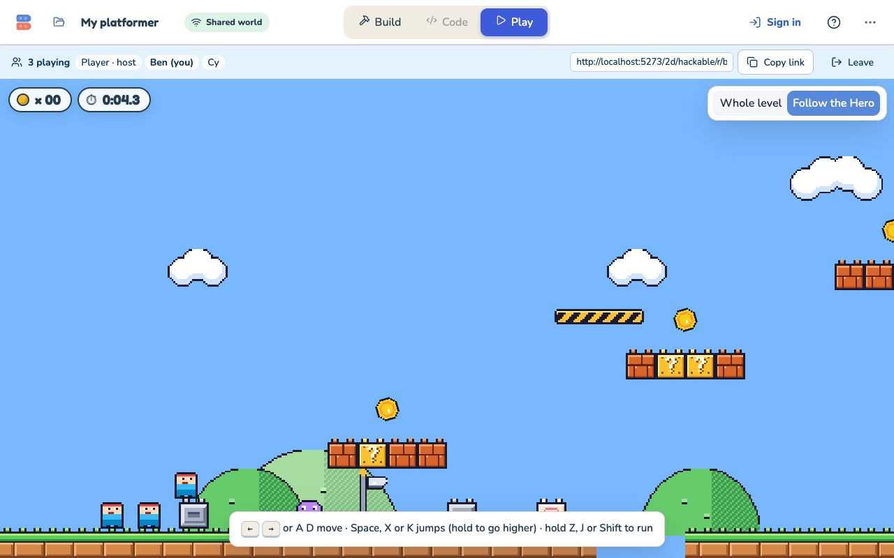 | 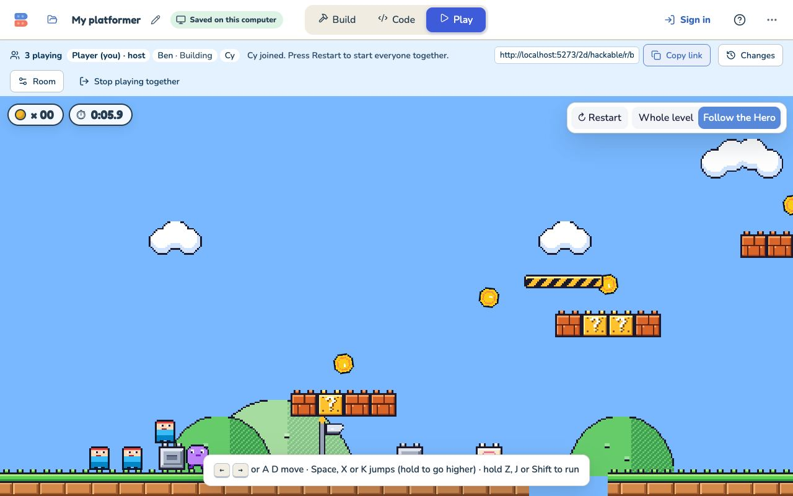 |
| 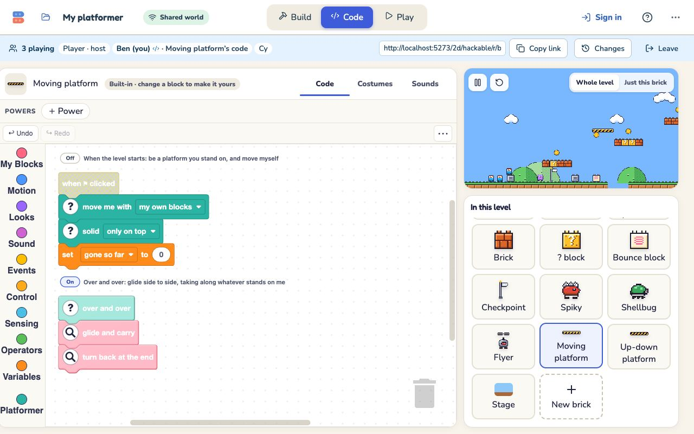 | 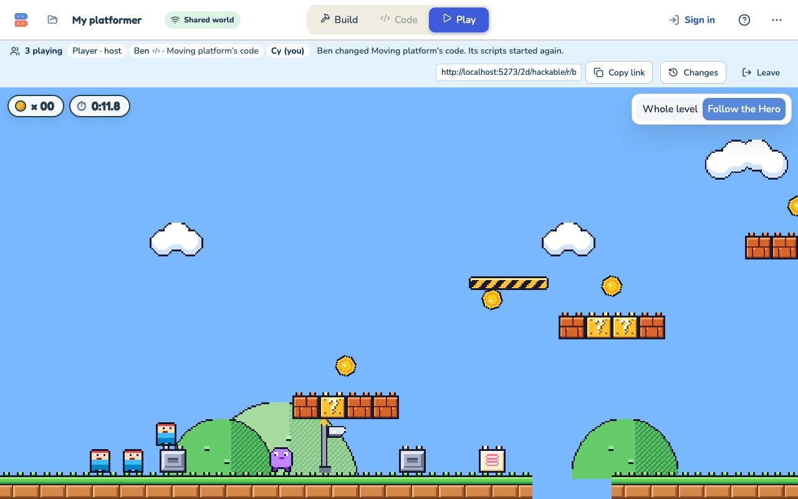 |
| 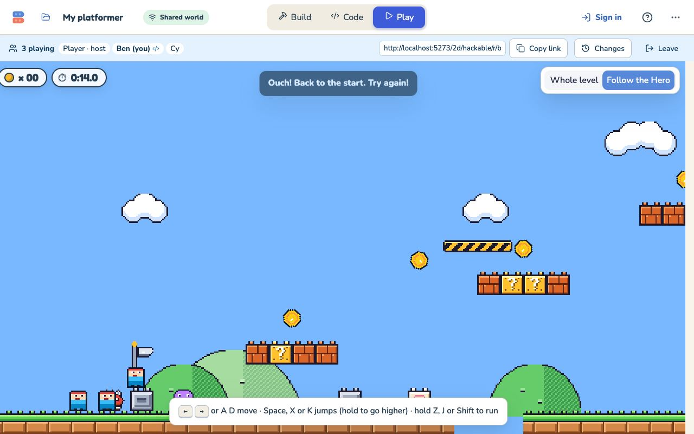 | 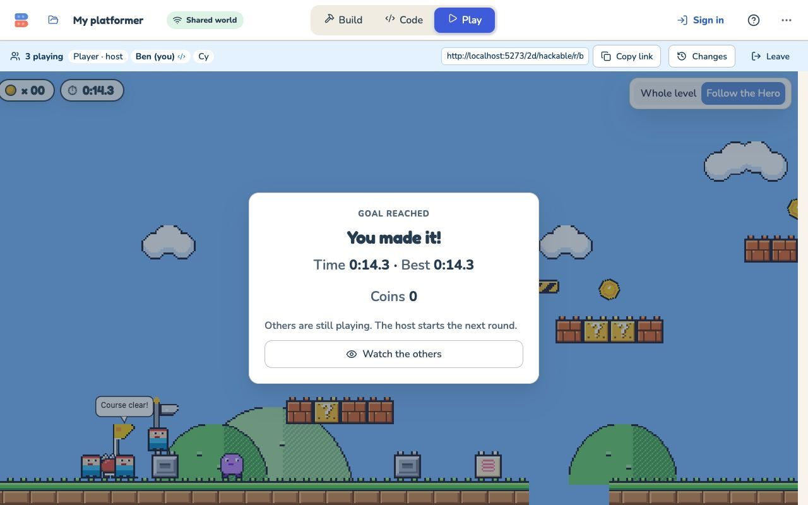 |
| 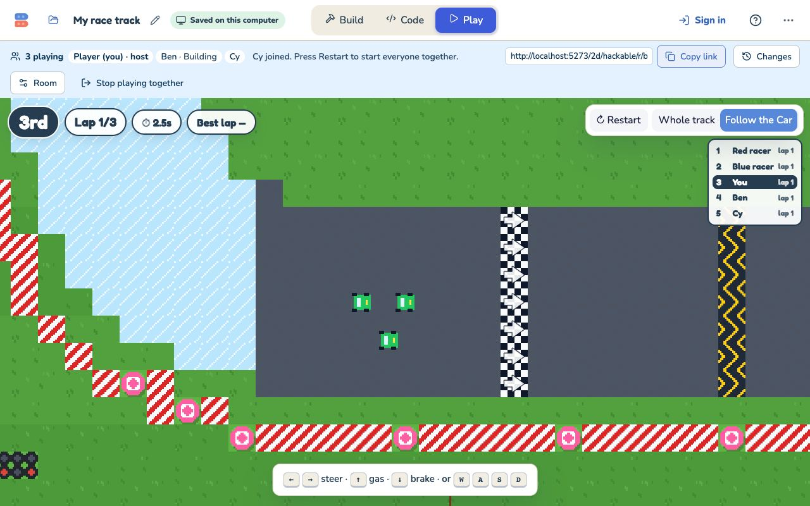 | 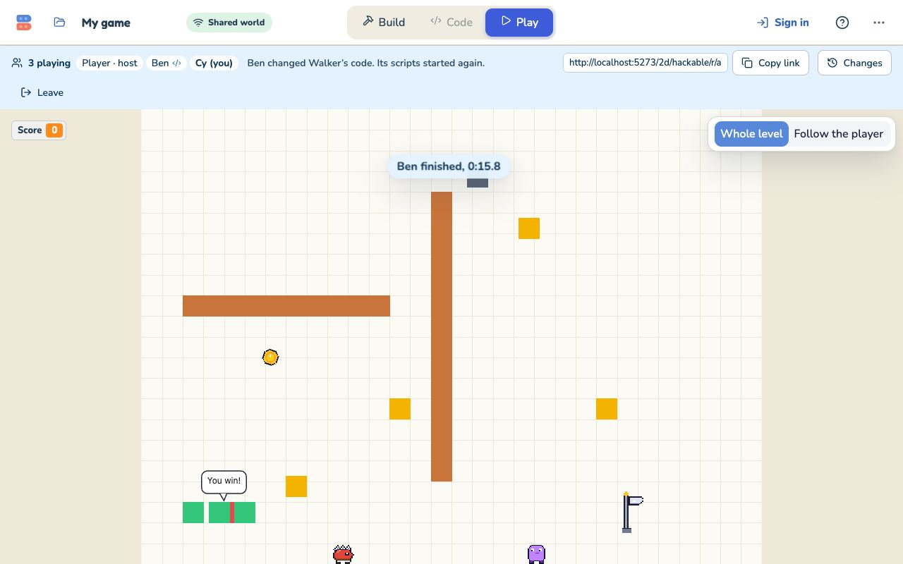 |
| 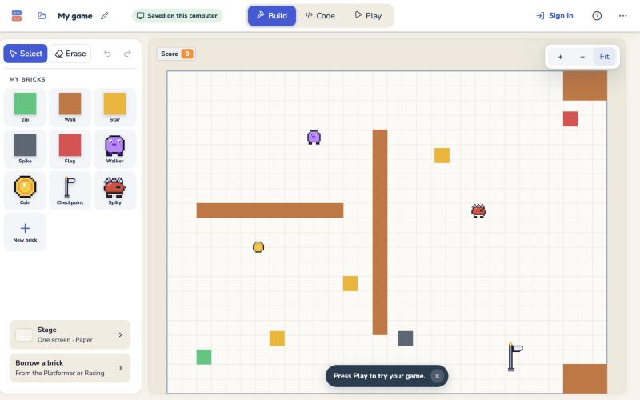 | 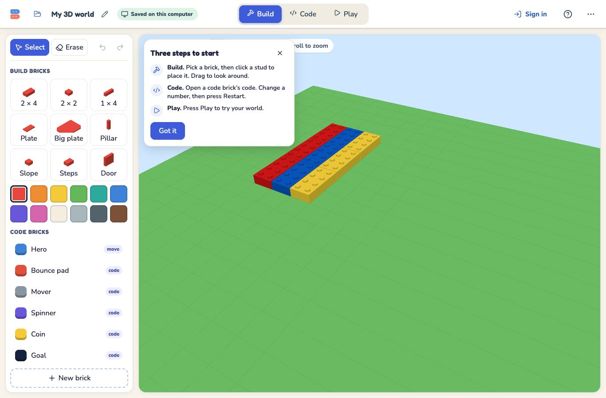 |
| 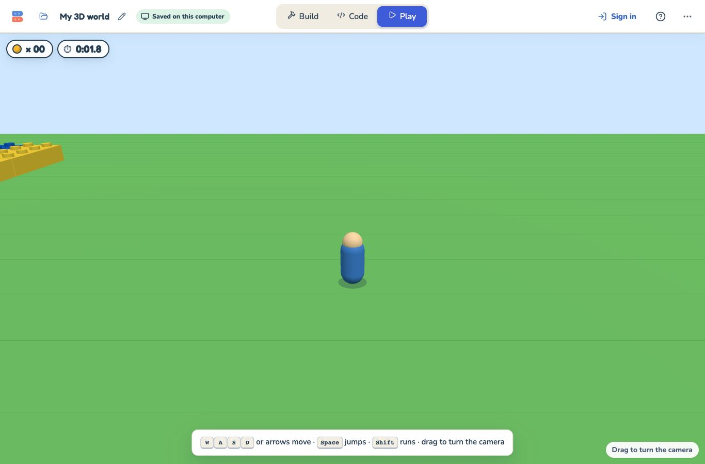 | 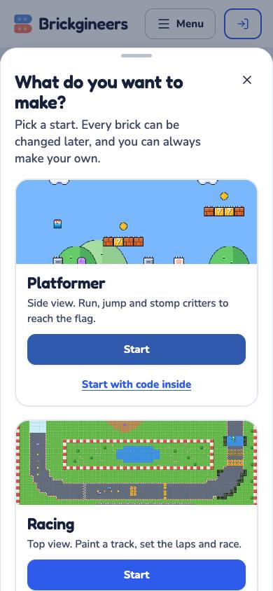 |

There are more in [`shots/rooms`](shots/rooms) (local Worker), [`shots/staging`](shots/staging) (the staging
Worker), [`shots/solo`](shots/solo) (3D and the ways in) and [`shots/blank-2d`](shots/blank-2d). Each harness writes a
`report.json` beside its shots.

## 6. Staging class room: blocked on test credentials

M2's class rooms have never run with real sign-ins.

- **What was done:**
  - After `npm run test:worker` (267 passed), the Worker was deployed to staging:
    `npx wrangler deploy --env staging` in `multiplayer/worker`. The result is `brick-studio-multiplayer-staging`,
    version `49a6eed8-2828-4b42-b6b4-98417967b105`.
  - It has the same bindings and no new Durable Object classes or migrations.
  - A `--dry-run` bundle of HEAD contains neither `HackableTimeline` nor `RoomBuilder` (the two client files changed
    after the deploy), so the staging Worker is HEAD's Worker code.
  - The three-kid guest-room harness passed against it (above).
- **What was not done: a class room with real sign-ins.**
  - The project's classroom harnesses (`scripts/verify-classroom-provider.mjs`, `verify-classroom-live-provider.mjs`)
    read `CLASSROOM_TEST_API`, `CLASSROOM_TEST_TEACHER_EMAIL`, `CLASSROOM_TEST_TEACHER_PASSWORD`, `SUPABASE_URL` and
    the service keys from the environment.
  - None are set here. No seed, fixture or staging doc in the repository provides them; the earlier QA run kept its
    session material in a private `/tmp` file outside the repository.
  - So, as instructed, I stopped there rather than use any other account.
- **Second attempt, with the owner's test teacher login (2026-11-04):**
  - The owner put `CLASSROOM_TEST_TEACHER_EMAIL` and `CLASSROOM_TEST_TEACHER_PASSWORD` in `.env.classroom-qa.local`
    (git-ignored; loaded into the process only, never printed). The file is well formed: an email and a 10-character
    password, with no quotes or stray whitespace.
  - The harness is `scripts/qa/wave2-classroom.mjs`, in three phases: `setup` makes the class, two students and one
    shared project, once; `run` runs the checks; `cleanup` switches the students off and closes the class.
  - Its first call, `POST /classroom/auth/teacher-login`, returned **401 `invalid_credentials`** from the staging
    Worker. One more login attempt against the production Worker's API, to tell a wiring problem from a credential
    problem, returned the same 401.
  - So the account or password is not accepted by the classroom sign-in. The cause could be a wrong password, an
    account that does not exist yet, an unconfirmed email, or an account that only signs in with Google.
  - **Nothing was created:** no class, no students, no project, no state file. So there is nothing to clean up. I did
    not retry further, so the account is not locked out.
- **What is needed:**
  1. A teacher login that `POST /classroom/auth/teacher-login` accepts (check it once in the browser's Teacher sign in).
     Then run:
     `set -a; . ./.env.classroom-qa.local; set +a; CLASSROOM_TEST_API=<staging Worker> CLASSROOM_TEST_ALLOW_FIXTURES=yes W2_STATE=<private file> node scripts/qa/wave2-classroom.mjs setup`,
     then the same with `run` (Vite from `w2-app-staging`, which now points both the classroom API and rooms at
     staging), then `cleanup`.
  2. Originally needed, still the same: a dedicated staging QA teacher login (or a `SESSION_STORAGE_FILE` for one), and confirmation that synthetic test
     classes may be created on the database the staging Worker uses.
  2. With those set as environment variables: create a synthetic class, register two synthetic students, and have the
     teacher share a Hackable project with the class.
  3. Then open `/2d/hackable/w/<world>` as the owner and the two students. Check:
     - the roles (students build, code off until allowed);
     - live edits;
     - write-behind saving to the class project, with an account reload showing the edit;
     - a recovery copy after a save from elsewhere (`GET /classroom/worlds/<id>/hackable-recovery`);
     - the owner's studio pausing its own saves in the room and resuming after.
  4. Afterwards, suspend the synthetic students and close the class, as the earlier harness does.

## 7. Decisions taken here (worth a look)

1. **"the player" is a menu choice in a game from nothing,** and Borrow rewrites a borrowed brick's "Hero" to it. A kid
   reading a borrowed Walker sees "touching the player?". The kits keep "Hero", so kit games are byte-for-byte the same.
2. **In a room, choosing the player is code and the backdrop is building** (`game` edit). Giving a brick a job also
   changes its code, so in a blank room a classmate gives jobs only once the host lets them code. That follows the owner
   decision ("code editing is off until the host allows it"), but jobs are a blank game's main building action. If the
   owner wants jobs to count as building, that is a one-line change in `kindOf`.
3. **The Checkpoint speaks to each Hero whose start is more than 24 steps from the flag.** A player whose own start is
   already within 24 steps of a flag is not told (they would come back there anyway).
4. **The flag picture is everyone's.** Only the newest flag is up for the whole room, while each player's start is their
   own.

## 8. What is unverified

- **Class rooms with real sign-ins** (section 6), including:
  - write-behind saving to a class project;
  - recovery copies;
  - the owner's studio pausing and resuming its saves.

  These are covered by the Worker test with the real Durable Object and the classroom fixture, not by a browser.
- **Racing per-player finish in a browser** this time (M2 did it in its round 3, and unit tests cover it).
- **Sounds from replayed ticks** are still dropped, as before, so a player hurt by someone else's late edit sees "Ouch"
  but may not hear it. Broadcasts are fixed; notes are not.
- **Blank in a room still lacks** the name tags over each friend's copy, and the invite line for a game with no player.
  A Goal job's "You win!" speech bubble on the Flag shows for everyone. These are lane E.
- **A Walks-around or Drives player** gets no checkpoint from a borrowed Checkpoint. Only the Runs-and-jumps job (the
  Hero's scripts) listens for "checkpoint".
- **Fingerprint samples in the browser are short:** 8 to 13 ticks per game, every 60 ticks, over the stretch every
  browser still kept. The long, tick-by-tick evidence is lockstep.
- **Not tried:** Firefox, real phones and Chromebooks, two coders on the same brick at once, a project near the 900 KB
  room limit, and production traffic.
- **A 3D design picks up an empty 2D tile layer.** The shell's `ensureTiles` adds one at mount; it is harmless, and it
  is the same on the 3D lane's own tip.

## 9. Deploy order, for a later ship

1. **The Worker first:** `multiplayer/worker`, `npm run test:worker`, then `npx wrangler deploy --env staging` (done:
   `49a6eed8`), then production `npx wrangler deploy`.
   - There is no new Durable Object class and no migration. `HackableRoom` gains M2's storage keys (`workspaces`,
     `recovery:<id>`).
   - The new Worker is backward compatible with the site in production: that site never sends `edit` or the `game`
     operation, and ignores the new fields.
   - The new site needs the new Worker. An old Worker refuses `edit` and has no blocks to hand out.
2. **Then the site** (Vercel), from this branch once it is merged. `npm run build` runs `tsc -b`, which now passes;
   it would not have before `fce5b428`.
3. **No database migrations.** The Blank and 3D kits are stored inside the project document (`document->save->design->>kit`),
   and the shelf's `GAMES` list is Worker code.
4. **Smoke test after deploying:**
   - open a Hackable project's room from the studio;
   - join it in a second browser;
   - place a brick from each browser;
   - from the Room menu, let the second player change code, and have them press Code at once (nothing should change);
   - change a brick's code there;
   - in a game from nothing, give a brick a job after code is on.

## Re-running

```bash
npx tsc -p tsconfig.app.json --noEmit
npx vitest run
npm run test:worker
npx vitest run src/platformer/lab/feel
node scripts/qa/lockstep/run.mjs --strict-rejoin --out /tmp/lockstep
node scripts/qa/lockstep/run3d.mjs --out /tmp/lockstep3d
UI_ORIGIN=http://localhost:5273 node scripts/qa/blank-2d.mjs
W2_BLANK_FILE=$PWD/scripts/qa/fixtures/wave2-blank-room.brickgineers UI_ORIGIN=http://localhost:5273 node scripts/qa/wave2-rooms.mjs
UI_ORIGIN=http://localhost:5273 node scripts/qa/wave2-solo-and-ways.mjs
```

The browser scripts need the dev servers from `.claude/launch.json` (`w2-worker` on 8798, `w2-app` on 5273, and
`w2-app-staging` on 5274 for the staging Worker).
